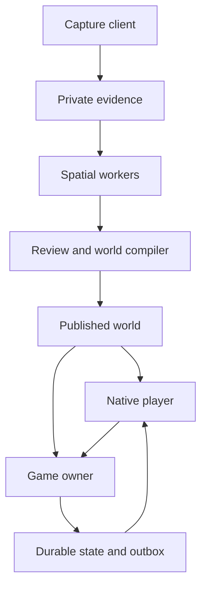
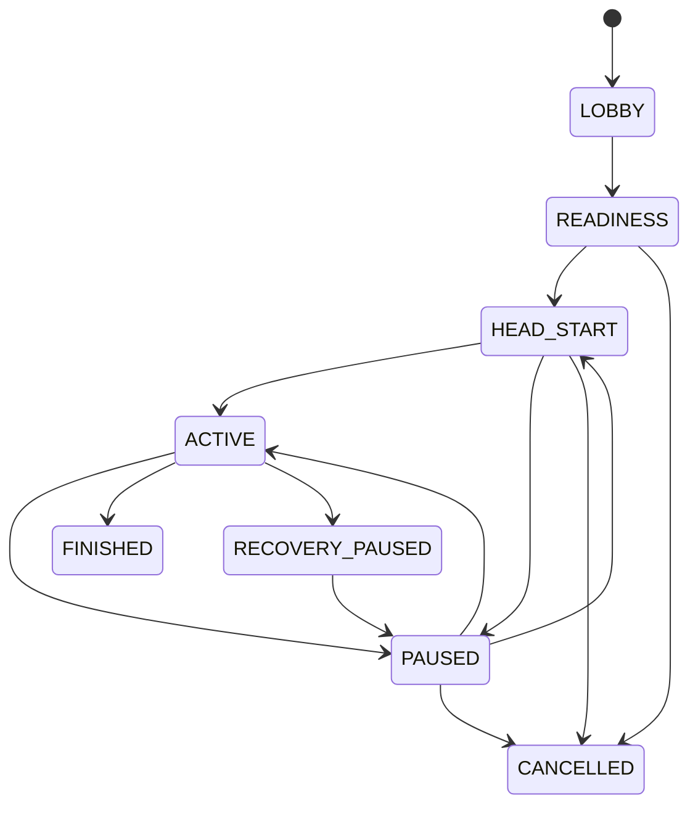
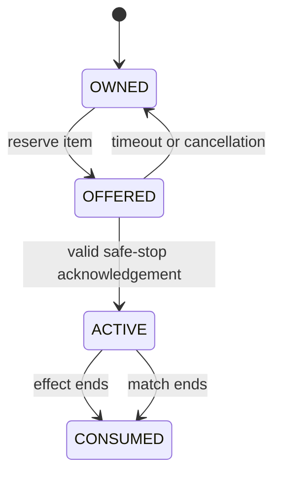
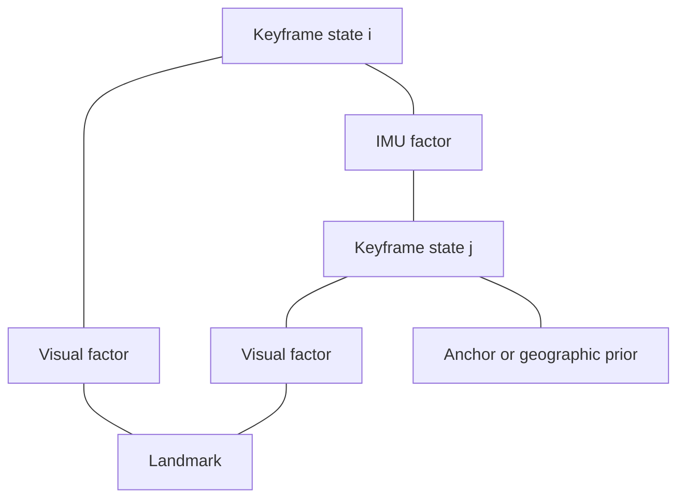
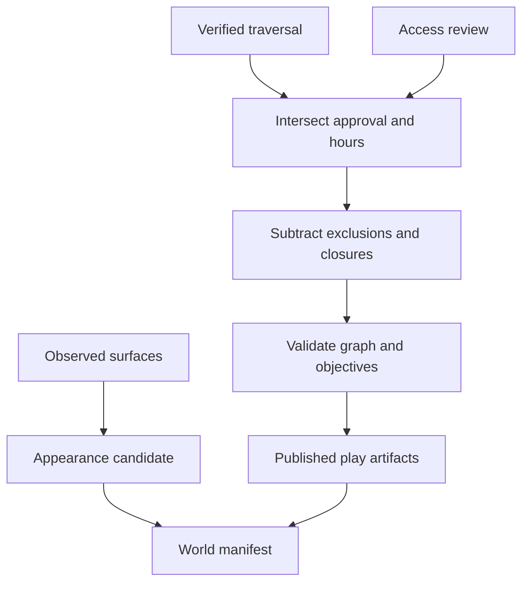
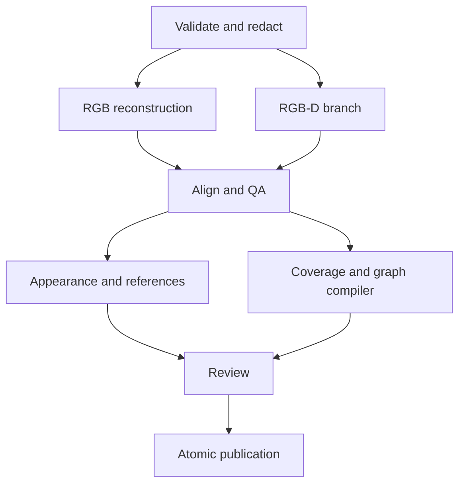

# ECHO
## Engineering and Game Systems Design

**Document:** TDD 1.0 / 30 October 2026.  
**Baseline:** ECHO Product Blueprint V2.0, current Markdown version 1, retrieved 30 October 2026.  
**Purpose:** specify the game machinery, spatial-computing pipeline, mathematics, interfaces, failure behavior and implementation sequence.  
**Status:** proposed implementation design. No application, campus reconstruction or supported-device benchmark is claimed complete.

> Build one consistent machine: capture produces evidence; spatial processing produces a reviewed world; a deterministic referee runs the game inside that world; clients display only the information they are permitted to know.

The PRD describes the intended product. This document makes engineering choices underneath it. Every important subsystem below identifies its inputs, state, algorithm, outputs, authority, failure modes and verification. Design rationale explains the tradeoffs. Equations state their assumptions. Pseudocode is a specification sketch rather than a claim of production-ready code.

The architecture supports a simple GPS demo and a technically ambitious scan-to-play product. The demo is a client and rules configuration against the same authority model; the flagship adds native capture, reconstruction, registration, verified coverage, topology-aware gameplay, localization and world streaming.

**Notation and contract:** capitals denote matrices or transforms; lower-case letters denote vectors/scalars according to context; times on the wire have explicit units. A transform named T(A<-B) maps coordinates in frame B into frame A. Display equations are editable LaTeX in this Markdown and typeset in the PDF. Computational examples use synthetic coordinates, not a surveyed BITS Goa map.

**Decision labels:** **Specified** is a concrete choice for TDD 1.0. **Configurable** is a versioned preset parameter. **Measured** is reserved for an actual experiment. **Unresolved** identifies a question requiring evidence. An illustrative target is not a measured capability. New engineering refinements to the PRD are recorded in section 01.3 rather than silently changing the game.

**Reading map:** 01-13 define the live game; 14-23 define the spatial mathematics and client world; 24-27 define processing, publication, schemas and trust; 28-30 define tests, operations and implementation; 31 contains the source index and glossary; 32 ends with the complete stack, repository layout and release workflow.

---

# 01. Scope, authority and decisions that must stay explicit

## 01.1 Three kinds of truth

ECHO has **physical facts**, **observations**, and **game decisions**. A runner physically standing behind a wall is a fact. A phone reporting a position with an accuracy estimate is an observation. A server issuing a coarse disclosure or confirming a mutually acknowledged catch is a game decision.

The system must never pretend these are interchangeable. A server can authoritatively prevent a consumed item being used twice. It cannot authoritatively prove that a human stopped moving for eight seconds using ordinary GPS. A reconstruction can support a geometric model; it cannot by itself grant permission to enter a building.

| Domain | Authority | Evidence it uses | What it does not establish |
| --- | --- | --- | --- |
| Game phase, inventory, effects, result | Game service and durable committed state | Validated commands, clocks and current world | Physical compliance |
| Latest participant pose estimate | Accepted sensor pipeline with uncertainty | GNSS, optional explicit localization, quality metadata | Exact position or honest device |
| World geometry | Versioned reconstructed assets and QA | Calibrated images/depth/control references | Current access permission |
| Playable territory | Approved published mask plus restriction overlay | Verified traversable coverage, access review, closures | Safety under every unobserved real change |
| Capture | Server records a human encounter confirmation | Two participants and a short-lived challenge | A GPS-derived physical touch/line of sight |
| Presentation | Client projection of authorized state | Recipient-specific views and approved assets | New rules or hidden knowledge |

The PRD is the source of intended behavior [A01]. This TDD defines operationally precise contracts for implementing it.

## 01.2 Core invariants

I01: one current authoritative owner per match; stale owners cannot commit.

I02: a command with one actor/session identity and command ID has one durable outcome; retrying it cannot create another grant.

I03: an item is owned, reserved, consumed or discarded; transitions never produce negative inventory or two owners.

I04: a station generation grants at most one reward.

I05: a captured/withdrawn player cannot issue a later gameplay action; a playing host has no privileged opponent feed.

I06: a client receives only its authorized projection, not a hidden full-state object.

I07: gameplay time does not advance during a pause. Wall-clock offers are explicitly cancelled or expired, never accidentally resumed.

I08: an unobserved or unapproved region never becomes playable because a mesh looks complete.

I09: a match pins one base world version and one ruleset. Runtime restrictions can subtract permission; expansion requires a new publication/round.

I10: appearance failure can degrade visuals; authority-asset failure blocks readiness.

I11: a reconstruction job cannot publish without the required review and compatible artifact hashes.

I12: leave/capture/end stops player-location acquisition locally, and server access revocation prevents further game disclosures.

These invariants become property tests and operational assertions. They are more useful than promising that every screen works on a happy-path recording.

## 01.3 Engineering refinements to the PRD

The PRD deliberately left some mechanisms approximate. This TDD resolves them as implementation proposals, without overwriting the PRD.

| ID | Refinement | Reason and consequence |
| --- | --- | --- |
| D01 | A pickup hold is at least 3 chase seconds and must contain two distinct acceptable fixes; it may take longer until the evidence arrives | A requested 3-5 second sampling cadence cannot guarantee two new fixes inside exactly 3 seconds |
| D02 | A remote catch request alone cannot forcibly disable the runner; a real verbal encounter creates the human stand-down, and the runner explicitly enters/acknowledges the encounter | Otherwise a malicious hunter could manufacture remote freezes by requesting catches |
| D03 | Safety pause is a barrier at the next owner turn; terminal match expiry still wins at its exact deadline | Avoid delaying a stop behind ordinary commands while retaining deterministic finish semantics |
| D04 | Ordinary action decisions use owner decision time, not client time or unauthenticated claimed tap time | Prevent deadline backdating; queue delay is measured and bounded by release gates |
| D05 | Reported horizontal accuracy is not automatically a Gaussian covariance or a hard containment radius | Avoid false mathematical confidence |
| D06 | Raw sensor updates are serialized into the owner's private observation state but are not appended to the permanent public gameplay event log | Preserve coherent query snapshots without retaining a route archive |
| D07 | Recovery enters a pause at the latest durable checkpoint, marks the round degraded, and requires resynchronization | The system cannot reconstruct an exact unobserved physical timeline after a crash |
| D08 | Wire schemas start at echo.game/1 and echo.world/1; PRD schema snippets are illustrative predecessors | Give the implementation one precise compatibility contract |

These refinements need product review when implementing the corresponding feature. They are not requests to simplify the technical ambition.

## 01.4 Concrete initial configuration

| Parameter | Classic Signals | Signal Districts |
| --- | --- | --- |
| Head start | 60,000 ms | 60,000 ms |
| Chase limit | 1,080,000 ms | 1,200,000 ms |
| Pulse interval | 90,000 chase ms | 90,000 chase ms, chosen here as the initial inherited value |
| Bright pulse / historical lifetime | 12,000 / 90,000 chase ms | Same |
| Freeze offer / active / immunity | 5,000 wall ms / 8,000 / 45,000 chase ms | Same |
| Failed-offer retry cooldown | 10,000 chase ms | Same |
| Sweep radius / cooldown | 100 m / 60,000 chase ms | Graph Sweep uses a 100 m route budget where enabled |
| Inventory | 2 slots, duplicate type limit 1 | Same unless an explicitly versioned preset changes it |
| Station hold / respawn | Minimum 3,000 / 120,000 chase ms | Same for ordinary inventory stations |
| Catch request lifetime | 15,000 wall ms | Same |
| Relay / extraction | None | 3 distinct relays across 2 districts; 6,000 ms relay hold; 5,000 ms extraction hold |
| Extraction opening | None | Up to 180,000 chase ms, bounded by original match deadline |

Location and alert thresholds remain pilot hypotheses: acceptable measurement age at most 10 seconds and reported accuracy at most 25 m; technical pause after 20 seconds of unusable/unreachable state. Section 08 defines how to evaluate age honestly. These values require actual campus/device tests.

# 02. Runtime architecture and dependency direction

## 02.1 Execution domains

The game plane contains a native player, a small authoritative service, a durable database and a safe-delivery outbox. The spatial plane contains a capture client, private evidence storage, asynchronous processing, review tools, a world compiler and an immutable publication registry.

Unity/C# is the flagship rendering/capture host. Swift/Kotlin adapters own platform-specific sensor and background-location work. TypeScript owns live rules and protocol validation. Python/C++ workers own spatial processing. These choices retain the product direction from the PRD while separating workloads with very different latency and memory requirements.



The pipeline emits data, not executable creator scripts. The game service validates against published authority artifacts. It never asks a dense reconstruction worker whether a catch should succeed.

## 02.2 Module boundaries

| Module | Input | Owns | Output |
| --- | --- | --- | --- |
| NativeSession | User consent, app lifecycle, platform callbacks | Sampling task and bounded upload queue | Timestamped observation batches, health |
| ProtocolGateway | Authenticated HTTPS/WebSocket messages | Schema validation, rate limits, routing | Typed owner inputs |
| MatchOwner | Ordered commands, observations, due time | Private live state and deterministic decisions | Proposed state/event/projection changes |
| CommitStore | Proposed mutation with owner epoch/revision | Atomic durable write and receipt | Committed revision/outbox |
| Projection | Committed state, recipient identity and current time | Visibility policy | Safe snapshots/events |
| CaptureRecorder | Camera/IMU/GNSS/depth capabilities | Synchronized evidence segments | Immutable capture bundle |
| Reconstruction | Validated bundle references | Spatial algorithms and QA candidates | Registered model and quality reports |
| WorldCompiler | Reviewed coverage/access/graph/assets | Consistent authority artifacts | Candidate manifest |
| Publication | Approved candidate and signatures/hashes | Version promotion and restriction state | Immutable world release |

The pure rules package must not import database, rendering, camera, notification or cloud-vision SDKs. It accepts typed observations and explicit time. This enables deterministic tests and synthetic fixtures.

## 02.3 One owner, durable guards

Initially one process hosts multiple serial match owners. Each match has one mailbox. Expensive graph queries are bounded; reconstruction and image inference never run in that mailbox.

When scaling across processes, a registry routes a match to a lease holder. Every mutating transaction checks a monotonically increasing **owner epoch**, not merely a cached distributed lock. An expired process can still be alive, so its old epoch must fail at the durable write boundary.

If the database cannot confirm a mutation, the owner cannot report success or publish its consequences. A notification is delivery, not state. A successful outbox send is not a human acknowledgement.

## 02.4 Deployment shape

Start with one region for the game service and database, chosen through actual tester latency and data-handling decisions. Use separate CPU/GPU workers and storage access for spatial jobs. A GPU outage prevents new worlds from being built; it does not invalidate a previously published arena.

The first deployment need not contain a service for every table. It needs the boundaries above, clear credentials, reproducible builds and failure isolation. A small modular deployment and a later distributed deployment implement the same contracts.

# 03. Time, deterministic ordering and deadline semantics

## 03.1 Three clocks

Use **wall time** for audit records, lease expiry and short wall-lifetime offers; **server monotonic time** for stable intervals inside one process; **logical gameplay time** for head start/chase/effects/cooldowns.

A phone's clock controls no authoritative deadline. Sensor timestamps describe observations and have their own association model. They are not proof that a command was sent earlier.

**Equation M01 - accumulated chase time.**

$$
g(t)=g(t_0)+\int_{t_0}^{t}\mathbf{1}\{\operatorname{phase}(s)=\mathrm{ACTIVE}\}\,ds
$$

Within one active segment, store the logical base and monotonic anchor. On pause, materialize elapsed time and clear the running anchor.

**Equation M02 - phase-local clock evaluation.**

$$
g(m)=
\begin{cases}
g_{\mathrm{base}}+(m-m_{\mathrm{anchor}}),&\text{ACTIVE},\\
g_{\mathrm{base}},&\text{PAUSED or terminal}.
\end{cases}
$$

Head start has a separate logical accumulator. Reusing chase time for head start creates off-by-one errors in the first pulse and match limit.

## 03.2 Deadline domains

| Object | Domain | Pause behavior |
| --- | --- | --- |
| Chase end, pulse schedule | Chase time | Remaining duration preserved |
| Active Freeze, immunity, item cooldown | Chase time | Remaining duration preserved |
| Station respawn, completed objective progress | Chase time / durable state | Timer freezes; progress stays |
| In-progress station/relay/extraction hold | Chase time plus evidence continuity | Attempt cancelled on pause |
| Unacknowledged Freeze offer | Wall lifetime | Cancel and release reservation on pause |
| Unconfirmed catch request | Wall lifetime | Cancel into explicit encounter/ruling state |
| Arena access hours | Wall time | A pause does not extend access; closing can terminate a paused round |
| Owner lease and health timeout | Operational wall/monotonic time | Still evaluated |
| Native local stop timeout | Device monotonic elapsed time | Still evaluated; cannot certify global state |

A timer row stores its domain explicitly. Never infer domain from the field name or from which screen displays it.

## 03.3 Pulse scheduling

For interval I and chase limit L, pulses have positive integer indices with index times strictly below L. A pulse at L does not happen.

**Equation M03 - pulse set.**

$$
\mathcal{P}=\{\,kI:k\in\mathbb{N},\ k\ge1,\ kI<L\,\}
$$

For Classic Signals, I = 90 s and L = 1080 s: indices 1 through 11 produce pulses at 90 through 990 seconds. Index 12 is excluded. Persist the next pulse index and a unique deadline/event ID. A delayed terminal handler materializes final chase time at L, never at an overshooting scheduler wake-up time.

A pulse snapshots acceptable observations once. Twelve seconds of bright display does not mean twelve seconds of live tracking. Historical lifetime is measured from disclosure in chase time, while the measurement age shown to the user remains honest wall/observation age.

## 03.4 Total ordering

At each owner turn:

1. Authenticate/validate the outer input and choose server decision time.
2. If the chase limit is reached, finish before accepting gameplay actions.
3. Apply a queued safety-pause barrier before ordinary actions and nonterminal reveals.
4. Process other due deadlines in stable priority and ID order.
5. Revalidate and process the next ordinary input under the resulting state.
6. Atomically persist its accepted outcome; only then emit safe consequences.

Inside one decision instant, order by terminal transition, explicit safety barrier, offer/catch expiry, effect expiry, respawn, pulse, then ordinary mailbox order. An item whose offer expiry equals the acknowledgement decision time is expired. A Freeze ending at that instant has ended before a new action, but immunity still blocks re-freezing.

Every committed mutation gets a monotonically increasing per-match sequence. Client timestamps, UUID ordering and packet arrival on different transports do not decide ties.

## 03.5 Worked pause example

Freeze starts at chase 120 s and expires at chase 128 s. At wall 123 s, chase time is 123 s and the match pauses. It resumes 30 wall seconds later. Five chase seconds remain; expiry is at wall 158 s if no other pause occurs. Immunity ends at chase 173 s, not wall 173 s.

The recipient must not use a wall-clock countdown started when the push arrived. It renders a server logical deadline and resynchronizes on resume.

## 03.6 Queue delay and commit uncertainty

The chosen decision time is when the owner begins evaluating the input. A queued command reaching the owner after match end loses even if the phone claims an earlier tap. Instrument ingress-to-decision delay; an overloaded service must pause or shed work instead of silently making competitive deadlines unfair.

The owner must not make a success visible before durable commit. Bound decision-to-commit latency and stop ordinary progress if that budget is exceeded. A timeout is not proof of rollback: reconcile the durable receipt before retrying or releasing a reservation. If rollback is confirmed, reevaluate at the new current time. If the original transaction committed, honor that outcome once and enter the required degraded/pause path; never apply it again. Unknown commit status remains unresolved until reconciled. Eligibility is evaluated at decision time; a delayed durable outcome is a recorded operational failure, not permission to backdate a new decision. The initial performance target is p95 command receipt under 1 second on connected devices; it is not measured yet.

# 04. State machines and terminal outcomes

## 04.1 Match phase machine



PAUSED stores the prior resumable phase and its clock accumulator. Recovery is a distinct reason/state because it requires rebuilding durable state, fresh health and explicit synchronization. FINISHED and CANCELLED reject gameplay commands permanently.

## 04.2 Orthogonal participant state

Do not encode every combination in one status string. Store participation, role, health, encounter and effect states independently.

| Axis | Values | Important invariant |
| --- | --- | --- |
| Participation | JOINED, READY, ACTIVE, CAPTURED, WITHDRAWN | CAPTURED/WITHDRAWN never becomes active in this round without an explicit mode transition |
| Role | RUNNER, HUNTER, STEWARD | Role changes require a mode rule and subscription reset |
| Health | GOOD, DEGRADED, UNAVAILABLE | Good socket health does not imply a fresh measurement |
| Encounter | NONE, OFFERED, ENTERED, CONTESTED | An unsolicited offer cannot impose a runner penalty |
| Effect | Freeze offer/active/immunity records | Frozen and unavailable can coexist |
| Device session | epoch, credential, expiry | Old device epoch cannot act or receive future private views |

The effective action guard is the conjunction of relevant axes, not a UI button state.

## 04.3 Eligibility predicate

**Equation M04 - action eligibility.**

$$
\begin{aligned}
\operatorname{eligible}(a,x)={}&
\operatorname{phaseAllows}(a)\land\operatorname{roleAllows}(a,x)\\
&\land\operatorname{participating}(x)\land\operatorname{healthyEnough}(a,x)\\
&\land\neg\operatorname{blockedByEncounterOrEffect}(a,x)
\end{aligned}
$$

Location-dependent actions add a current pose-quality and effective-region predicate. Human safety pause and leaving remain available regardless of inventory, role or Freeze state.

## 04.4 Terminal result rules

Classic Signals finishes HUNTERS_WIN if all original runners were confirmed captured and no withdrawal invalidated competitive completeness. At chase expiry, RUNNERS_WIN if an eligible runner remains; degraded/withdrawn rounds carry an explicit practice/incomplete flag.

Signal Districts finishes RUNNERS_WIN on a valid extraction claim after the relay requirement. It finishes HUNTERS_WIN on all confirmed captures or expiry without valid extraction, subject to completeness status.

A last-runner connectivity failure triggers technical pause, not victory. A last-hunter withdrawal ends incomplete. A removed participant never counts as a capture. The result object includes winner if meaningful, completeness, degradation reasons, final sequence and rules/world versions.

## 04.5 Teardown is a state transition

On capture/withdrawal, revoke future gameplay permissions, cancel relevant offers/holds, clear or discard inventory according to the mode, stop player-location acquisition, and remove future private subscriptions. Previously authorized coarse information can only survive until its declared expiry; no new route history is revealed.

On round end/cancel, stop all native sampling, expire gameplay jobs, close session credentials, schedule retention cleanup and show a definitive tracking-stopped state. An offline client stops locally without waiting for a successful leave request. Reconnection later reconciles withdrawal and cleanup; it does not resume tracking automatically.

# 05. Command processing, atomicity and idempotency

## 05.1 Linearization point

The durable transaction commit is the point at which a gameplay action becomes real. The owner computes a candidate transition against one immutable private observation/state snapshot, but that candidate is not published until the database confirms its fenced revision.

For the first implementation, all accepted location updates and gameplay inputs pass through the same match mailbox. Location updates change a private observation map; they do not create permanent route events. A command copies the necessary observations at the start of evaluation. This avoids a scan reading one runner before an update and another after an unrelated partial mutation.

A long database wait cannot leave the owner indefinitely deciding against old time. Stop ordinary progress and reconcile the commit outcome under section 03.6; reevaluate only after confirmed rollback. Heavy spatial jobs never run in this transaction path.

## 05.2 Transaction shape

```sql
BEGIN;
SELECT revision, owner_epoch, phase
FROM game.matches
WHERE match_id = :match_id
FOR UPDATE;

-- Reject unless epoch, revision and effective state still match.
-- Look up the immutable command receipt under the authenticated member.
-- A matching duplicate returns that receipt; a changed body is rejected.

UPDATE game.matches
SET revision = :next_revision, state_blob = :new_state
WHERE match_id = :match_id
  AND owner_epoch = :owner_epoch
  AND revision = :expected_internal_revision;

-- Require exactly one updated row.
INSERT INTO game.command_receipts (...);
INSERT INTO game.events (...);          -- safe internal audit fields
INSERT INTO game.outbox (...);          -- already filtered intended payloads
COMMIT;
```

This is a transaction skeleton; the actual schema, parameterization, error handling and constraints are mandatory. Match-row locking and revision/epoch guards serialize critical mutations. PostgreSQL documents row locking and isolation behavior [A02, A03]. Serializable isolation is an optional stronger guard for cross-match/shared-resource operations, with retry handling; it is not a substitute for defining ownership and lock order.

Station, inventory and effect changes belong in the same transaction as the receipt. Do not grant an item and separately publish an event that might fail or duplicate.

## 05.3 Receipt contract

Key receipts by match ID, authenticated member ID and command ID. Hash the normalized semantic command body and relevant preconditions. A duplicate ID with a different body is IDEMPOTENCY_CONFLICT. The original receipt is immutable.

A command receipt says its intent was COMMITTED or REJECTED. An accepted Freeze request has result OFFER_CREATED; the offer lifecycle can later become ACTIVE, CANCELLED or EXPIRED. Retrying the original request returns the original receipt plus a separately labelled current resource view. It does not create another offer or rewrite history.

Keep non-coordinate receipts for the round's supported retry/audit lifetime, proposed at 30 days. Closed-match tombstones reject old actions even after detailed receipts expire. This provides idempotent durable effects over at-least-once transport, not a claim of exactly-once packet delivery.

## 05.4 Outbox and recipient revocation

The outbox stores an event reference, intended recipient/scope, safe payload, expiry and delivery attempts. A dispatcher sends after commit and records delivery progress. Failure to send does not undo the game action; the client recovers through receipts and an authorized snapshot.

Recheck membership/session eligibility before sending future private information. Discard expired disclosures. Removing a participant revokes subscriptions and new snapshot access. Information already legitimately delivered cannot be cryptographically recalled from a human's memory or screenshot.

Do not place raw locations in a generic event object and rely on the frontend to hide them. Safe projection happens before the payload becomes deliverable.

## 05.5 Fencing and ownership failure

A process lease has an expiry and an increasing owner epoch. Acquire/renew it through a durable operation; check the epoch on every mutation. Database time evaluates lease validity; local monotonic time only schedules renewal attempts.

On lease loss, stop acting immediately and stop presenting a live referee. A stale owner can receive messages, but cannot commit under its old epoch. A new owner reconstructs durable state, cancels invalid pending reservations, enters RECOVERY_PAUSED and requires fresh observations.

Do not let Redis ownership and a database revision disagree silently. Redis may help routing; the durable write guard determines who can change the match.

## 05.6 Crash cases

| Failure point | Durable outcome | Recovery |
| --- | --- | --- |
| Before transaction | Nothing accepted | Retry same ID |
| During transaction before commit | Rollback | Retry same ID under current state |
| Commit succeeds, response lost | Action exists once | Fetch receipt/snapshot |
| Outbox sends twice | Action still exists once | Recipient deduplicates event/view ID |
| Process dies after reservation | Reservation and offer exist durably | Recovery cancellation releases item once |
| Stale owner sends a late packet | No new durable mutation | Client checks epoch/view state; resync |
| Receipt exists but current view changed | Historical receipt remains true | UI shows receipt separately from current resource state |

# 06. Wire protocol, reconnection and synchronization

## 06.1 Envelope and limits

Use HTTPS for command/snapshot/receipt fallback and ordinary WebSocket for foreground low-latency delivery. Socket.IO has a different protocol; do not connect a plain WebSocket client to a Socket.IO server and expect compatibility.

The versioned game envelope contains protocol version, match ID, command ID, device-session epoch, command type and typed payload. Identity comes from the credential. Client-supplied actor IDs are ignored/rejected. Wire times are integer milliseconds within the JSON safe-integer range. High-resolution capture timestamps are decimal strings or binary integers, not unsafe JSON numbers.

```json
{
  "protocol": "echo.game/1",
  "matchId": "opaque-match-id",
  "commandId": "opaque-unique-id",
  "sessionEpoch": 4,
  "type": "USE_FREEZE",
  "payload": {
    "itemId": "owned-item-id",
    "targetMemberId": "hunter-member-id"
  }
}
```

Initial implementation limits are design defaults: 16 KiB per ordinary command, bounded location batches up to 20 samples, strict finite-number/range validation, and configurable per-command rates. Uploading survey imagery uses a separate API/storage path. Rate-limit repeated catch/Freeze attempts independently from ordinary health messages.

## 06.2 Revision channels

Keep internal match revision/sequence separate from per-recipient view sequence. Exposing every hidden internal event number can reveal activity timing. The public phase/roster stream has its own revision; each recipient receives a contiguous private sequence for its authorized view.

A snapshot includes current phase, logical clocks, own inventory/effects, public arena/roster state, authorized unexpired disclosures, required world/closure revision, server time and recipient sequence. It never includes an all-player observation table.

If a client detects a sequence gap, it stops applying dependent incremental state and requests a snapshot. A delta carries its expected predecessor. Duplicate deltas are ignored. A stale delta cannot resurrect an expired effect.

## 06.3 Reconnect handshake

Authenticate, verify member/device epoch, report the last recipient sequence and world hash, then obtain the current snapshot. The server can supply missed still-valid safe events, but snapshot reconstruction is the correctness path. Expired coordinates and cancelled offers are not replayed for completeness.

A device switch revokes the old session, increments its epoch, clears pending upload nonces and requires a new health/location check. Changing the socket does not create a second player or reset inventory.

Commands that timed out keep their original IDs until the client retrieves the receipt. Retrying under a new ID is a new intent and may spend a second item if allowed.

## 06.4 Clock-offset estimate for display

Let c0 be client send time, s1 server receive time, s2 server send time and c3 client receive time. All values are represented in milliseconds with an explicit bridge from each monotonic clock to its exchanged reference.

**Equation M05 - display time synchronization.**

$$
\widehat{\theta}=\frac{(s_1-c_0)+(s_2-c_3)}{2},
\qquad
\widehat{\delta}=(c_3-c_0)-(s_2-s_1)
$$

This familiar round-trip estimate assumes path symmetry for the point offset. It cannot prove one-way delay. Prefer low-delay samples, reject absurd jumps and maintain an uncertainty estimate. Clock synchronization supports presentation and observation association; it never authorizes backdated commands.

Worked synthetic sample: c0 = 1000, s1 = 1045, s2 = 1047, c3 = 1022 gives offset 35 ms and network round-trip estimate 20 ms. A symmetric-path interpretation has about 10 ms one-way uncertainty before clock drift/model error. Asymmetric networks can be worse.

## 06.5 Client countdown

**Equation M06 - predicted displayed chase time.**

$$
\widehat g(c)=g_{\mathrm{ref}}+
\mathbf{1}\{\mathrm{ACTIVE}\}
\max\bigl(0,c+\widehat{\theta}-s_{\mathrm{ref}}\bigr)
$$

Clamp the displayed remaining duration to a sensible nonnegative range and resynchronize on phase changes. Local completion of the countdown does not grant an action; current authoritative state still validates every command. On stale synchronization, display uncertainty/offline state rather than a precise-looking timer indefinitely.

## 06.6 Delivery and local stop behavior

Push contains a safe event reference and expiry, not coordinates. The client fetches current state when opened. A push accepted by APNs/FCM is not proof of delivery or human perception [A04]. Expired Freeze offers are discarded even if the notification arrives later.

If accepted health contact disappears, each client independently enters a stop-play state after its configured timeout. This cannot guarantee that every human stopped at the same instant. Resume requires the required roster to acknowledge the effective state; inability to reach a participant is a reason to remain paused/end incomplete.

# 07. Native session machinery and background operation

## 07.1 State ownership on the device

The native session controller owns permission state, participant/session binding, location task lifecycle, upload queue and stop conditions. Unity owns the foreground experience and rendering. The controller exposes a small typed interface: startSession, stopSession, updatePhase, getHealth, drainAcceptedUpdates and acknowledgeState.

```text
IDLE -> CHECKING -> ARMED -> RUNNING
RUNNING -> SUSPENDED_UI       (native task may remain active)
RUNNING/SUSPENDED_UI -> STOPPING -> IDLE
ANY -> PERMISSION_LOST -> STOPPING
ANY -> SESSION_REVOKED -> STOPPING
```

The arrows here describe a lifecycle contract, not an assertion that every OS keeps a task running. Device process termination, permission removal and vendor battery behavior remain observable failure cases.

## 07.2 Platform adapters

The Android adapter uses the appropriate current location APIs and declared active-game service/notification model. The iOS adapter uses Core Location authorization/background configuration appropriate to the supported OS/build. Validate the actual implementation on the selected device matrix [A05, A06].

Do not assume Unity continuing to render in background is required or sufficient. The native task performs short authenticated uploads when the platform permits. A suspended WebSocket alone does not mean the participant is offline if valid native health/location messages continue.

Capture is a foreground camera session with a different consent and data lifecycle. It must not run as an accidental side effect of ordinary chase. Camera-off play is the default outside explicit stopped localization.

## 07.3 Sampling and buffering

A starting request is one accepted movement sample every roughly 3-5 seconds, with adaptation measured on actual devices. Faster foreground bursts can support a deliberate station interaction. The OS can delay/batch samples; a requested rate is not a guarantee.

Each sample has provider measurement time, a local monotonic association, sample sequence, source profile, coordinates, reported accuracy and session epoch. Batches preserve the original times. A buffered sample does not become fresh because the server just received it.

Use a bounded queue by age and size. Once older than the mode's useful freshness horizon, retain only what is necessary for a fault report without raw route export, or discard. Never drain a long offline route into fresh-looking game state. On leave/capture/end, stop sampling and clear queued coordinates locally.

## 07.4 Health model

Track transport contact, accepted measurement freshness, permission, sensor quality, app lifecycle and alert readiness separately. A fresh heartbeat with stale coordinates is HEALTHY_TRANSPORT / DEGRADED_LOCATION. A good GPS fix with no uplink is not live game participation.

A location upload also counts as health contact. A captured player may send minimal non-location connection state if needed for the round UI, but their gameplay location acquisition stops.

Readiness exercises the selected alert configuration. Do not infer a human heard an alert from a successful SDK callback. The Freeze acknowledgement is explicit.

## 07.5 Shutdown and resumption

Local stop executes even when the network fails. Store a small non-coordinate pending-leave marker, revoke local credentials where appropriate, and reconcile later. The server's health timeout and membership rules prevent indefinite invisibility.

Restarting the app does not silently resume tracking. Reauthenticate the session, learn whether the match is still active/paused/terminal, obtain consent/permission state and rebuild the latest view. An old native task must not keep uploading under a revoked device epoch.

# 08. Location estimates, freshness and uncertainty

## 08.1 Accepted observation model

Store one current accepted observation per participant plus a bounded private quality buffer, proposed at 30 seconds. The owner orders observations by session epoch and sequence, evaluates measurement time and quality, and rejects duplicates, impossible values and excessively old samples.

The raw sample is not a trusted statement of physical truth. A modified client can spoof it. Server authority prevents digital rule manipulation; it cannot turn commodity GPS into physical-proof infrastructure.

## 08.2 Measurement age

Represent measurement time in server reference time as an interval when association is uncertain. Let the observation have plausible server time bounds tMin and tMax. The oldest plausible age is used for a conservative freshness decision.

**Equation M07 - age bound.**

$$
a_{\max}(t)=t-t_{\min},\qquad
\operatorname{fresh}(t)\Longleftrightarrow
0\le a_{\max}(t)\le A_{\max}
$$

The interval comes from provider timestamp association, local monotonic age-at-send, recent clock bridging and an operational network uncertainty allowance. Those bounds are estimates, not a cryptographic guarantee. If association is uncalibrated or the allowance is exceeded, mark freshness uncertain and reject precision-dependent interactions.

At minimum, server time since receipt gives a lower bound on age. It can prove a sample is too old, but cannot prove freshness without knowing how long it was queued before arrival.

## 08.3 Operational radius versus covariance

A provider's reported horizontal accuracy has provider-specific semantics. Record its source and confidence meaning when known. TDD 1.0 treats it as an **operational radius input** for the pilot's quality rule, not automatically a hard bound or one standard deviation.

If a calibrated Gaussian model is explicitly available, use its covariance and declare the confidence convention. Do not mix a 68%-style provider radius with a 95% ellipse as if they were the same object.

**Equation M08 - a calibrated 2D confidence ellipse.**

$$
\mathcal E_\alpha=
\left\{x:(x-\mu)^\mathsf T\Sigma^{-1}(x-\mu)
\le \chi^2_{2,\alpha}\right\}
$$

At 95% and two degrees of freedom, the chi-square value is about 5.991, giving multiplier sqrt(5.991), about 2.448 [A07]. For diagonal standard deviations 3 m and 4 m, ellipse semiaxes are about 7.34 m and 9.79 m. This is a synthetic Gaussian example, not a claim about phone error distribution.

## 08.4 Motion estimation

A simple server display/quality estimator can use planar position and velocity with a constant-velocity transition. It is optional and separate from raw accepted measurement storage. Do not use prediction to fabricate a fresh scheduled disclosure.

**Equation M09 - planar motion model.**

$$
x_{k+1}=
\begin{bmatrix}I_2&\Delta t I_2\\0&I_2\end{bmatrix}x_k+w_k,
\qquad
z_k=\begin{bmatrix}I_2&0\end{bmatrix}x_k+v_k
$$

For white acceleration noise density q, a common continuous-time model gives process covariance blocks proportional to dt cubed, dt squared and dt.

**Equation M10 - process covariance.**

$$
Q=q\begin{bmatrix}
\frac{\Delta t^3}{3}I_2&\frac{\Delta t^2}{2}I_2\\
\frac{\Delta t^2}{2}I_2&\Delta t I_2
\end{bmatrix}
$$

Declare the units and noise model. This is not the same formula as independently sampled constant acceleration over an interval, which has different powers/coefficients.

## 08.5 Innovation gating and correlated inputs

**Equation M11 - innovation test.**

$$
r=z-H\widehat x^{-},\qquad
S=HP^{-}H^\mathsf T+R,\qquad
d_M^2=r^\mathsf T S^{-1}r
$$

A large innovation suggests an outlier or a bad motion/noise model. It is not proof of cheating. Quarantine a suspect update, request fresh evidence and show degraded state; never auto-ban from one jump.

ARKit/ARCore poses already incorporate internal sensing. Fusing their output and the same raw IMU again as independent measurements double-counts information. Keep a declared provenance/model for each estimate. Unknown covariance must not be replaced with an artificially tiny matrix.

## 08.6 Boundary predicate

Let P be the fixed effective play polygon and U the operational uncertainty region around a position.

**Equation M12 - three-way classification.**

$$
\operatorname{region}(U,P)=
\begin{cases}
\mathrm{INSIDE},&U\subseteq P,\\
\mathrm{OUTSIDE},&U\cap P=\varnothing,\\
\mathrm{UNCERTAIN},&\text{otherwise}.
\end{cases}
$$

The default fine-grained reward gate requires sufficient confidence. An uncertain edge gives a warning/relocalization path, not instant elimination. World boundary quality and player uncertainty are distinct; do not enlarge the published region to accommodate a noisy fix.

## 08.7 Coarse disclosures

Use a stable local metric grid per world/disclosure version. For cell width q and origin o, quantize each horizontal coordinate by floor. Negative coordinates require mathematical floor, not truncation toward zero.

**Equation M13 - cell index.**

$$
i=\left\lfloor\frac{e-o_e}{q}\right\rfloor,\qquad
j=\left\lfloor\frac{n-o_n}{q}\right\rfloor
$$

With q = 25 m, e = -1 m and origin zero, i = -1, not zero. Reveal the corresponding cell/expanded uncertainty area, sample time and source event. Do not add fresh random offsets on every query that can be averaged into a more precise estimate.

The private raw point is absent from the recipient payload. A result remains a snapshot until its expiry; the client cannot interpolate it along an undisclosed route.

# 09. Ability machinery and game-balance mathematics

## 09.1 Ability definitions are data plus trusted handlers

A versioned ability definition declares permitted role, item type, target domain, cost/reservation, quality preconditions, duration domain, cooldown, immunity, counter rules and recipient disclosure policy. The handler is reviewed server code. Creator-authored data can choose approved templates; it cannot execute arbitrary scripts in the referee.

The lifecycle is validate, reserve if needed, resolve, consume/cancel, emit authorized consequences, expire. Each transition has a durable resource ID. A countdown animation never consumes an item by itself.

## 09.2 Freeze state machine



The item is consumed at activation; ACTIVE here describes the associated effect/resource lifecycle. Keep item state and effect state separate in storage to avoid interpreting the diagram as a second consumption on expiry.

On USE_FREEZE, require active runner, own available Freeze, acceptable caster observation, eligible reachable named hunter, no existing target offer/effect/immunity, no failed-offer retry cooldown and no blocked encounter. Create a 5-second wall offer and reserve the item. There is no distance requirement in this preset.

On ACK_FREEZE, authenticate the target, process due time, require unexpired offer and both participants still eligible, validate a fresh caster observation again, consume the reserved item, start the 8-second chase effect, and create coarse caster disclosures for active hunters. These are one committed mutation.

The target acknowledges that they stopped safely; the app cannot verify physical stationarity perfectly. Before acknowledgement, the hunter is not frozen. A capture committed first can remove caster eligibility and cancel the offer.

## 09.3 Cancellation and immunity

Timeout, caster capture/withdrawal, target withdrawal, safety pause, match end or recovery can cancel an unactivated offer. Release its reservation exactly once and emit no caster disclosure. A failed offer starts the 10-second retry cooldown. Repeated unacknowledged offers are operational incidents, not automatic cheating proof.

At activation time g0, Freeze expires at g0 + 8 s and immunity ends at g0 + 53 s. During Freeze the hunter cannot capture, scan or collect, but can read already-authorized information. Pause preserves remaining effect and immunity time.

An acknowledgement at the 5-second wall expiry loses because expiry is processed first. A repeated acknowledgement returns its original receipt. Another runner cannot stack a second offer on the same target.

## 09.4 Sweep resolution

Require current hunter eligibility, owned Sweep, expired personal scan cooldown and an acceptable origin observation. Snapshot eligible runner observations. If none is usable, reject SCAN_UNAVAILABLE without cost. Otherwise consume the item and start a 60-second chase cooldown, even if no confirmed signal is found.

For distance d and operational radii aH/aR, define e = aH + aR.

**Equation M14 - Euclidean Sweep classification.**

$$
\begin{aligned}
d+e\le R&\Rightarrow \mathrm{CONFIRMED\ IN},\\
d-e>R&\Rightarrow \mathrm{CONFIRMED\ OUT},\\
\text{otherwise}&\Rightarrow \mathrm{UNCERTAIN}.
\end{aligned}
$$

This triangle-inequality rule is conservative only relative to the assumed operational regions. The regions are not guaranteed physical containment. A confirmed result reveals a coarse area to the using hunter and warns the actually disclosed runner. Uncertain edge results are anonymous. Unusable signals are counted honestly.

Synthetic example: d = 70 m, aH = 8 m, aR = 12 m, R = 100 m gives confirmed in. At d = 90 m with the same radii, the result is uncertain. At d = 125 m it is confirmed out.

## 09.5 Caster disclosure and effect ordering

A successful Freeze includes an information cost. The caster's current coarse snapshot is computed at acknowledgement decision time, not taken blindly from an earlier offer. If the caster's observation is now unusable, cancel/reject activation according to the defined reason without spending; do not reveal an old point as fresh.

A Freeze effect does not suppress a scheduled pulse or another hunter's valid Sweep. The independent mechanisms have independent IDs and expiries. If several authorized signals refer to the same runner, the UI may combine them while preserving source/sample times and avoiding a fabricated live track.

## 09.6 Fixed-loadout balance bound

With six runners starting with one Freeze each and no additional Freeze grants, at most six successful activations occur. Total controlled hunter time is at most 48 hunter-seconds, before considering failed offers or overlap prevention.

**Equation M15 - fixed inventory control budget.**

$$
U_{\mathrm{team}}\le
\frac{N_{\mathrm{freeze}}\,f}{N_H L}
=
\frac{6\cdot 8}{2\cdot1080}
\approx0.0222
$$

That is about 2.22% of total hunter-time under this specific fixed-loadout assumption. It says nothing about how annoying a particular moment feels or the physical stop/attention overhead.

If stations replenish Freeze, the inventory bound changes. Immunity alone limits starts and complete effects by the effect-plus-immunity cycle. A last effect can be cut short by match end, so those counts are distinguished.

**Equation M16 - per-target scheduling upper bound.**

$$
\begin{aligned}
N_{\mathrm{started}}&\le\left\lceil\frac{L}{f+i}\right\rceil,\\
N_{\mathrm{full}}&\le\max\left(0,1+\left\lfloor\frac{L-f}{f+i}\right\rfloor\right).
\end{aligned}
$$

For L = 1080 s, f = 8 s and i = 45 s, both bounds are 21. At L = 1065 s, up to 21 starts but only 20 complete effects fit. These calculations assume positive L, an initially available target and immediate first activation; actual item supply, acknowledgements and positioning reduce the achievable count. Therefore loot budgets and cooldowns must be part of balance, not only the eight-second duration.

## 09.7 Value of information and physical time

A freeze adds roughly runner speed times active duration to potential separation while the hunter is stationary, but the real route and acceleration matter. At a hypothetical walking speed of 1.5 m/s, eight seconds corresponds to 12 m of travel. This is arithmetic, not a recommended physical benchmark or a predicted campus outcome.

For a toy model with uniformly distributed independent runners, expected scan hits equal runner count times the fraction of legal area covered.

**Equation M17 - toy scan expectation.**

$$
\mathbb E[K]=N_R\,
\frac{\operatorname{area}(P\cap B_R)}
{\operatorname{area}(P)}
$$

Campus movement is not uniform, and graph access, hiding choices and GPS quality violate the assumptions. Use this only to reason about scale. Balance should use actual useful leads, capture timing, pause rate, role agency and repeat-play feedback.

## 09.8 Reachability after an old ping

An old signal is evidence at its measured time. Its possible future locations expand along permitted connectivity, not through every wall.

**Equation M18 - graph reachability envelope.**

$$
\mathcal R(\Delta t)=
\{x\in G:\exists y\in U_0,\ d_G(y,x)\le v_{\max}\Delta t\}
$$

The speed bound is a game-analysis assumption, not proof about a person. Do not display a secretly computed prediction as if it were a fresh reveal. This envelope is useful for design/testing and potentially an explicitly declared clue mode.

# 10. Captures, station claims and spatial objectives

## 10.1 Capture encounter protocol

The physical convention remains a no-touch verbal call at roughly 3 m with line of sight. Both humans stop safely. The digital system records their agreement; it does not infer the catch from GPS.

A hunter submits REQUEST_CAPTURE with target alias/member ID. The server creates a short-lived challenge, visible only to the hunter, and an offer to the runner. The hunter enters an encounter state that blocks their unrelated gameplay actions. The runner's unrelated actions are blocked only after the runner explicitly enters the encounter or confirms the challenge. An unsolicited remote request cannot forcibly stop them.

The runner can acknowledge the encounter, submit the challenge/confirmation, or contest. Confirmation before request and match expiry commits the catch atomically, cancels the runner's holds/offers, clears active inventory and revokes gameplay tracking. A contest pauses for a steward ruling. Expiry never awards an automatic catch.

A broad distance-plausibility check may reject an obviously remote request when acceptable observations exist; its threshold includes uncertainty and is not a three-meter capture detector. If this guard is used, expose the rejection reason without revealing the target's coordinates.

## 10.2 Challenge design

Use a server-generated unpredictable challenge with an attempt limit, short expiry, match/encounter/participant binding and hashed storage. A four-digit human-friendly code can be acceptable only with strict online attempt limits; it is not a general authentication credential. Hashing a low-entropy code does not protect it from offline guessing after database compromise; expiry, session binding and strict online attempts are essential. A later QR carries a signed/opaque encounter reference, not raw opponent location.

A request ID cannot be reused for another target. A capture confirmation cannot consume a challenge from another round. Duplicate valid confirmation returns the existing result. Rate-limit request creation to prevent encounter spam.

The local stand-down is a physical agreement after a real call. Remote coercion is prevented by the server guard described above. This is a concrete refinement of the PRD's shorter wording.

## 10.3 Station hold

START_CLAIM records participant, station generation, locked replacement choice, starting chase time and evidence sequence. The hold is a minimum duration plus evidence continuity condition.

**Equation M19 - claim eligibility.**

$$
\operatorname{claimReady}=
(g-g_0\ge H)\land
(n_{\mathrm{distinct\ good\ fixes}}\ge2)\land
\operatorname{insidePatch}\land
\operatorname{continuityValid}\land
\operatorname{eligible}
$$

The two fixes must have distinct provider measurement sequences and fall within the attempt interval. Re-uploading the same fix does not count twice. If a sample gap exceeds the configured continuity allowance, a fix leaves the patch, quality becomes unusable, or the phase pauses, cancel the attempt. Station interaction can request a brief foreground sampling profile; actual arrival rate is still measured.

The first valid committed claim wins the station generation. Claim and inventory replacement are atomic. An inventory-full player locks a replacement selection before holding. If the inventory changed meanwhile, reject/restart rather than discarding a different item silently.

## 10.4 Station contention

Do not globally lock a station when a player first opens the sheet or starts holding; this would enable remote denial. Several attempts can coexist. The commit checks AVAILABLE plus the expected generation and atomically grants once. Losers receive ALREADY_COLLECTED with no cost.

On success, retain the claimed generation in COOLDOWN and set respawn deadline to current chase time plus 120 s. Respawn increments generation and produces the next available generation, not another reward for an old completion request. A closure disables the station regardless of its respawn timer.

## 10.5 Relay progression

Each relay is a reviewed landmark/station with a district ID. A successful six-second claim adds its stable ID to the runner team's activated set once and records the district. Repeating the same relay cannot increment progress.

**Equation M20 - unlock condition.**

$$
|\mathcal A|\ge3
\quad\land\quad
|\{\operatorname{district}(r):r\in\mathcal A\}|\ge2
$$

At unlock, atomically open the two approved extraction options and set their deadline.

**Equation M21 - bounded extraction window.**

$$
g_{\mathrm{exit}}=
\min(g_{\mathrm{unlock}}+180\text{ s},L)
$$

Successful relay activation discloses the activator's approximate cell to both hunters, bright for eight seconds with normal historical expiry. Shared progress is public; raw activation coordinates are not.

## 10.6 Extraction

An active runner completes a five-second hold inside an approved open extraction patch using the same evidence/continuity machinery. The server requires the relay condition and current chase time strictly below the extraction and match deadlines. A valid commit finishes the round for runners.

All captures before extraction or expiry without extraction favors hunters, subject to completeness/degradation policy. A relay activated at 19:30 in a 20-minute match opens at most 30 seconds; the match is not extended.

## 10.7 Objective invalidation by closure

A restriction overlay can disable a path, relay or exit. Recompute mode feasibility under the effective graph. A required objective becoming unreachable pauses the match. Use only a fallback selected and validated in advance, or end incomplete. Do not invent a new route or objective while players are already chasing.

# 11. Route graph, map matching, Graph Sweep and Path Decoy

## 11.1 Graph representation

Use a directed graph with stable node/edge IDs. Nodes represent approved junctions, anchors and objective connectors. Edges contain metric geometry/length, permitted direction, access window, width/clearance notes, level identity and closure dependencies.

A visual mesh is not the graph. A triangulation edge, roof overlap or nearest point does not establish a permitted route. Every published connection has supporting reviewed evidence.

A location can lie partway along an edge. Store its edge ID and arc-length interval, not only the nearest endpoint.

## 11.2 Candidate map matching

Generate nearby legal edge candidates compatible with world version, level if known and uncertainty. Do not snap a player across an exclusion because the opposite edge is numerically closest.

A probabilistic matcher can use observation likelihood and transition plausibility.

**Equation M22 - candidate observation score.**

$$
\log p(z_k\mid e)=
-\frac{d_\perp(z_k,e)^2}{2\sigma^2}
+\operatorname{const}
$$

Only use this Gaussian score if its noise interpretation is appropriate; otherwise label it a ranking heuristic. Transition scores can compare route distance with plausible displacement, direction and elapsed time. An online HMM/Viterbi-style implementation must be causal and retain bounded private state, not a permanent route archive.

**Equation M23 - causal best-path update.**

$$
V_k(e)=
\log p(z_k\mid e)+
\max_{e'}\bigl[V_{k-1}(e')+\log p(e\mid e')\bigr]
$$

A best candidate is not enough for a competitive precise rule. Keep plausible alternatives when ambiguity remains.

## 11.3 Exact edge-position distances

For points on distinct edges, shortest-path distance considers the permitted distances from each point to reachable endpoints, the node-to-node graph distance and the partial target edge. Directed edges require direction-aware cases.

For two points on the same bidirectional edge with coordinates s and t, include the direct distance absolute(s-t). Omitting this case can incorrectly route both points through an endpoint. Directed same-edge travel may require a legal loop if the target is behind the origin.

Use Dijkstra for nonnegative weights; A* can use an admissible lower bound such as Euclidean distance only when weights are true metric lengths and additional costs do not violate the bound. Do not use an optimistic heuristic as the returned route distance.

## 11.4 Uncertainty-aware Graph Sweep

Let UH and UR be plausible graph-position sets. Define shortest legal-path distances over all supported origin-target candidates.

**Equation M24 - graph distance interval.**

$$
d_{\min}=\inf_{h\in U_H,r\in U_R}d_G(h,r),
\qquad
d_{\max}=\sup_{h\in U_H,r\in U_R}d_G(h,r)
$$

Confirm in only if dMax is at most the scan budget. Confirm out if dMin exceeds it. Otherwise return an anonymous uncertain-edge signal. Infinite/unreachable pairs remain infinite; straight-line distance is never substituted.

For intervals along edges, extrema may need analytic endpoint/interior treatment or conservative bounds, not arbitrary sparse sampling that can miss a longer candidate. A finite sampled approximation must be labelled and inflated conservatively before becoming a rule.

Cache distance results under world version, closure revision, graph profile and relevant origin candidates. A closure invalidates the cache key.

## 11.5 Worked graph fixture

A and B are connected by a 160 m permitted path around a barrier. Their world positions are only 40 m apart. A 100 m Euclidean Sweep can classify them inside, while a 100 m Graph Sweep classifies them outside if the observation sets are tight enough.

On one 100 m bidirectional edge, positions at 20 m and 25 m have distance 5 m. Endpoint-only routing could wrongly return 45 m via the first endpoint. This fixture belongs in the graph test suite.

If origin candidates yield distances 80 m and 120 m to a target under a 100 m budget, the result is uncertain. Selecting only the nearest candidate to make the scan look successful violates the specified policy.

## 11.6 Path Decoy generator

The server creates the decoy at a permitted visited origin under the ability's defined scope. It selects a valid graph walk using a private deterministic seed, edge eligibility, plausible game pace and the current world/closure revision. It advances a virtual trajectory in chase time; a pause freezes it.

For edge lengths l1, l2 and so on and virtual speed v, traverse cumulative distance v times elapsed chase time. Split at junctions and stop or choose a legal continuation according to the preset. A closure affecting its future route cancels/replans only under a declared rule; it never crosses an unknown gap.

The seed and internal isDecoy flag are not sent to an opponent when the mechanic intends ambiguity. The opponent receives the same EnemySignal schema, ID style, precision and timing metadata as an indistinguishable real signal. Visible statistical clues can still exist; hiding a flag is not a promise of perfect deception.

Decoys never impersonate safety messages, modify physical movement permission or replay retained private human trajectories. Expiry/reveal behavior is a ruleset field.

# 12. Information projection and adversarial inference

## 12.1 Projection as a pure policy

The projector takes committed state, recipient identity/role, logical time and current membership. It returns a view containing only authorized fields. Its input can contain private observations; its output cannot accidentally serialize them.

Use explicit output types and allowlists. Avoid spreading a full domain object into JSON and deleting a few fields. A hidden-field blacklist fails when a new field is added.

## 12.2 Disclosure ledger

A disclosure records recipient, source event, subject presentation ID, coarse geometry, measurement time, creation time, bright deadline and expiry. Its source can be a scheduled pulse, Sweep, Freeze cost, relay cost or decoy, but opponent-facing metadata must respect the mechanic's intended secrecy.

A cancelled offer creates no disclosure. An expired disclosure is absent from new snapshots. A reconnect cannot extend its lifetime. A captured player's future channel authorization is revoked immediately.

## 12.3 Negative information and query budgets

An empty scan is information. Availability counts, repeated bearings, edge classifications and item eligibility can also leak facts. Define each deliberately and enforce cooldowns/budgets on the server.

A 25 m grid does not prevent inference from many independent queries. Stable quantization avoids averaging random offsets; it does not eliminate deductions from movement and repeated observations. Test the intended information economy using simulated adversarial query sequences.

Do not expose hidden global event counts through sequence gaps, client analytics, error details or debug endpoints. A public world asset contains terrain, not live private player data.

## 12.4 Projection tests

For each role and lifecycle state, assert forbidden fields are absent from snapshots, deltas, errors, notifications, presence, logs and telemetry. Test a role change with queued outbox messages and an old socket still connected.

A creator credential can inspect permitted spatial evidence but cannot inspect live opponent observations. A steward's incident access is separately scoped and audited. The playing host uses the same game projection as their role.

# 13. Client state, rendering and interaction correctness

## 13.1 Four client stores

Keep immutable world data, authoritative recipient game view, transient UI state and native health/sensor state separate. A user dragging the map must not mutate the world origin. A button animation must not mutate inventory before a receipt arrives.

Render an explicit pending state for an unresolved action. A committed command receipt and current resource state are separate concepts: OFFER_CREATED does not mean the hunter is already frozen.

## 13.2 Optimism policy

Local map gestures and cosmetic transitions can be optimistic. Spending, capture, Freeze activation, relay unlock and extraction victory cannot. They are displayed definitively only after committed safe state arrives.

Own-position smoothing can improve orientation with visible quality. Opponent snapshots remain fixed authorized areas; do not interpolate them toward an undisclosed current point. If a renderer cannot load a decorative LOD, use an approved proxy. If it cannot load authority geometry, readiness fails.

## 13.3 UI priority

Safety/technical stop dominates encounter, Freeze acknowledgement, item use and decorative feedback. An incoming offer has an expiry and current resource ID; it cannot be re-opened by an old push. A phase transition cancels obsolete modal interactions.

All deliberate camera interactions occur while stopped. The normal chase renderer can run at a reduced update budget when the phone is pocketed or the UI is backgrounded; native location/health work has its own lifecycle.

## 13.4 Cross-language contracts

Generate boundary types where useful, but also verify semantics with shared fixtures: timestamp units, integer ranges, quaternion order, frame names, floor behavior for negative grid indices, expiry equality and graph distances.

A JSON schema can prove a field is a number; it cannot prove that the number is meters rather than degrees. Unit/frame metadata and executable fixtures are part of the protocol.

## 13.5 Recoverable presentation

After reconnect, load the authoritative snapshot first, then reconcile pending receipts, then run any still-relevant animation once. Never replay an expired effect simply because its old event was missed. Show degraded or uncertain state honestly instead of leaving a confident icon frozen on screen.

# 14. Coordinate frames, transforms and geographic mathematics

## 14.1 Frame registry

| Frame | Definition | Precision / use |
| --- | --- | --- |
| WGS84 | Latitude, longitude, ellipsoidal height with declared datum | Exchange and global reference |
| ECEF | Earth-centered Cartesian meters | Geographic conversion |
| W | Local East-North-Up meters at a versioned world origin | Canonical campus geometry |
| S | One capture segment's local tracking frame | Provider-relative observations |
| B | IMU/body frame with declared axes | Owned estimator/calibration branch |
| C | Canonical camera: right, down, forward | Projection and reconstruction exchange |
| U | Unity world/render coordinates | Float rendering near a local origin |

Every stored transform names both frames and its version. A generic matrix field named pose without direction, units and convention is invalid.

## 14.2 Rigid and similarity transforms

**Equation M25 - transform definition and inverse.**

$$
T_{A\leftarrow B}=
\begin{bmatrix}R&t\\0&1\end{bmatrix},
\quad
p_A=Rp_B+t,
\quad
T_{B\leftarrow A}=
\begin{bmatrix}R^\mathsf T&-R^\mathsf Tt\\0&1\end{bmatrix}
$$

Composition follows frame cancellation: T(A<-C) = T(A<-B) T(B<-C). Rotations must satisfy orthogonality and determinant +1 within numerical tolerance.

For an arbitrary-scale monocular reconstruction, use a similarity pW = s R pS + t with positive scale. A metric provider pose should normally use rigid alignment after checking its scale, rather than silently rescaling an entire campus to hide bad calibration.

## 14.3 WGS84 to ECEF

With semi-major axis a, flattening f, squared eccentricity e2, latitude phi, longitude lambda and ellipsoidal height h:

**Equation M26 - ellipsoid conversion.**

$$
\begin{aligned}
e^2&=f(2-f),&
N(\phi)&=\frac{a}{\sqrt{1-e^2\sin^2\phi}},\\
x&=(N+h)\cos\phi\cos\lambda,&
y&=(N+h)\cos\phi\sin\lambda,\\
z&=(N(1-e^2)+h)\sin\phi.
\end{aligned}
$$

Use WGS84 a = 6378137 m and f = 1/298.257223563 through a tested geodesy implementation. GeographicLib's LocalCartesian describes geographic/local conversion [A11]. Store the height datum explicitly; mean-sea-level and ellipsoidal heights are not interchangeable.

## 14.4 ECEF to local ENU

Subtract the world origin's ECEF position, then rotate using origin latitude phi0 and longitude lambda0.

**Equation M27 - local basis.**

$$
p_W=
\begin{bmatrix}
-\sin\lambda_0&\cos\lambda_0&0\\
-\sin\phi_0\cos\lambda_0&-\sin\phi_0\sin\lambda_0&\cos\phi_0\\
\cos\phi_0\cos\lambda_0&\cos\phi_0\sin\lambda_0&\sin\phi_0
\end{bmatrix}
(p_{\mathrm{ECEF}}-p_{\mathrm{origin}})
$$

At an origin on the equator and zero longitude, a small ECEF displacement (0,1,0) maps to east, (0,0,1) to north and (1,0,0) to up. This synthetic basis fixture catches axis swaps without using private campus coordinates.

Do not subtract latitude/longitude directly and call the result meters. For graph costs and grid cells use a suitable local metric frame. Geographic distance queries can use PostGIS geography when appropriate.

## 14.5 Camera conventions and Unity handedness

COLMAP describes world-to-camera poses and camera axes right/down/front, with camera center equal to negative transposed rotation times translation [A12]. AR provider poses can use another camera convention. Convert explicitly at the adapter boundary.

A common ENU-to-Unity position basis is (east, up, north).

**Equation M28 - basis conversion.**

$$
p_U=Bp_W,\qquad
B=\begin{bmatrix}1&0&0\\0&0&1\\0&1&0\end{bmatrix},
\qquad \det(B)=-1
$$

B is a reflection/basis change, not a rotation quaternion. For a rotation mapping one local basis into another, use the output and input basis conversions on the correct sides.

**Equation M29 - orientation basis conversion.**

$$
R'=B_{\mathrm{out}}R B_{\mathrm{in}}^{-1}
$$

Only convert the resulting proper rotation to a quaternion. If both input/output bases change handedness, their determinants cancel. Test camera forward/up vectors, normals and triangle winding. A guessed quaternion sign flip is not a general solution.

## 14.6 Uncertainty propagation

For pW = s R p + t, with right rotation perturbation, additive world translation and additive scale perturbation, the local parameter Jacobian is:

**Equation M30 - similarity point Jacobian.**

$$
J_\eta=
\begin{bmatrix}
-sR[p]_\times&I_3&Rp
\end{bmatrix}
$$

If point uncertainty is independent of transform parameters:

**Equation M31 - transformed covariance.**

$$
\Sigma_W=s^2R\Sigma_pR^\mathsf T+
J_\eta\Sigma_\eta J_\eta^\mathsf T
$$

Joint parameter covariance can include cross terms inside SigmaEta. If the point and fitted transform share evidence, independence is an approximation; do not present the result as a calibrated confidence bound without validation.

# 15. Capture bundle, calibration and sensor-time association

## 15.1 Capture profiles

P0 records provider camera poses, images and available depth/mesh with declared provider quality. It uses ARKit/ARCore local tracking and does not claim access to their proprietary estimator internals.

P1 imports RGB imagery for SfM with explicit calibration/scale/georeferencing work. P2 records calibrated raw IMU plus camera data for an owned/offline visual-inertial research estimator. P2 is the branch whose reference mathematics appears in section 16.

Camera/IMU spatial and temporal calibration is a separate concern; Kalibr provides a primary reference for an owned raw-sensor workflow [A37]. The production manifest declares which profile produced each segment. Missing depth is a capability difference, not a malformed RGB capture.

## 15.2 Minimum evidence schema

```json
{
  "schema": "echo.capture/1",
  "captureId": "opaque-id",
  "segmentId": "opaque-segment-id",
  "clockDomain": "declared-monotonic-source",
  "poseConvention": "T_segment_from_camera",
  "cameraAxes": "right_down_forward",
  "units": "meters_radians",
  "calibrationRef": "sha256:...",
  "keyframesRef": "sha256:...",
  "imuRef": null,
  "depthProfile": null,
  "trackingGapsRef": "sha256:...",
  "permissionScopeRef": "private-record-id"
}
```

Each keyframe references image hash, dimensions, timestamp, camera ID, calibration group, pose/quality association and optional depth. Every transform/measurement has units and direction. Store source-provider timestamps as well as the canonical association when necessary.

## 15.3 Projection model

For a point in camera coordinates with positive z:

**Equation M32 - pinhole projection.**

$$
u=f_x\frac{x}{z}+c_x,\qquad
v=f_y\frac{y}{z}+c_y,\qquad
K=\begin{bmatrix}f_x&0&c_x\\0&f_y&c_y\\0&0&1\end{bmatrix}
$$

Lens distortion, crop, orientation and stabilization affect the actual mapping. A Brown-style radial/tangential model, when appropriate to the selected calibration, is:

**Equation M33 - example distortion model.**

$$
\begin{aligned}
r^2&=x_n^2+y_n^2,\quad d=1+k_1r^2+k_2r^4,\\
x_d&=x_n d+2p_1x_ny_n+p_2(r^2+2x_n^2),\\
y_d&=y_n d+p_1(r^2+2y_n^2)+2p_2x_ny_n.
\end{aligned}
$$

Use the declared camera model; do not force a fisheye or already rectified image into this model. Group intrinsics only when the physical camera and image formation settings justify it.

## 15.4 Resizing and pixel centers

If a resampler maps pixel-center coordinates by uNew = s(uOld + 0.5) - 0.5, then focal lengths scale by s and principal points follow the same center mapping. If the pipeline uses another coordinate convention, its calibration update must match that convention.

Cropping subtracts the crop origin from principal point coordinates. Rotation changes both intrinsics interpretation and image axes. Digital stabilization can create a frame-dependent crop. Record transformations or avoid uncontrolled setting changes. A sharp image with wrong calibration remains bad evidence.

## 15.5 Clock association and rolling shutter

Use an affine bridge between timestamp domains when needed.

**Equation M34 - clock-domain bridge.**

$$
t_{\mathrm{canonical}}=\alpha\,t_{\mathrm{sensor}}+\beta
$$

Estimate offset/drift and retain uncertainty. Do not assume camera, IMU, GNSS wall time and process uptime share an origin. Android Location exposes elapsed-realtime information useful for monotonic association [A33]; other sources require their own adapters.

For rolling shutter, row exposure time can depend on row index and readout duration. If that model is known, associate/compensate poses accordingly; if unknown, record the limitation and reject sufficiently motion-blurred/distorted frames. Assigning every row a precise center pose does not remove rolling-shutter error.

## 15.6 Depth semantics

Axial depth is camera z distance; range is distance along a ray. Their backprojections differ.

**Equation M35 - axial-depth backprojection.**

$$
p_C=D(u,v)\,K^{-1}\begin{bmatrix}u\\v\\1\end{bmatrix}
$$

For ray range, normalize the ray before multiplying by range. Store depth units, invalid values, confidence, camera relation and timestamp. A sensor depth image can have different resolution or intrinsics from RGB. Do not resize one and assume alignment.

## 15.7 Recorder implementation

Perform capability detection, select a profile and allocate bounded buffers. Keep camera textures on the GPU for preview; asynchronously convert/encode only selected persisted frames. Associate metadata before releasing provider buffers. Hash uploaded objects and retain a segment checkpoint.

A tracking reset creates a new segment with a new origin. It does not preserve an undocumented transform. Resume requires relocalization/alignment evidence. Use blur, overlap, tracking quality and motion to select frames; more footage is not always more useful reconstruction data.

# 16. Visual-inertial estimation and factor-graph mathematics

## 16.1 Role of this estimator

The default capture profile can use native provider poses as observations/priors. The following is a reference model for an owned/offline estimator and for understanding uncertainty, calibration and failure. It is not a claim about the exact internal algorithm of ARKit or ARCore.

Use a body-to-world rotation R, world position p, world velocity v, gyro bias bg and accelerometer bias ba. Gravity points downward in the ENU world. Use calibrated specific-force measurements, not a gravity-removed signal mistaken for raw acceleration.

## 16.2 Sensor model

**Equation M36 - IMU measurement equations.**

$$
\omega_m=\omega+b_g+n_g,\qquad
a_m=R^\mathsf T(\ddot p-g)+b_a+n_a
$$

The physical state has a quaternion/rotation plus vectors; the local error state has 15 components when orientation uses three tangent coordinates. Rotation perturbation conventions must remain consistent [A13, A14].

**Equation M37 - nominal dynamics.**

$$
\dot R=R[\omega_m-b_g-n_g]_\times,\quad
\dot p=v,\quad
\dot v=g+R(a_m-b_a-n_a)
$$

Biases follow a declared random-walk model. Noise densities, discrete sample covariance and bias priors have different units. Calibrate or estimate them from suitable data instead of copying unexplained constants.

## 16.3 Discrete propagation

For a short constant-measurement interval:

**Equation M38 - first-order propagation reference.**

$$
\begin{aligned}
R_{k+1}&=R_k\operatorname{Exp}((\omega_m-b_g)\Delta t),\\
v_{k+1}&=v_k+(g+R_k(a_m-b_a))\Delta t,\\
p_{k+1}&=p_k+v_k\Delta t+\tfrac12(g+R_k(a_m-b_a))\Delta t^2.
\end{aligned}
$$

Midpoint or higher-order integration can reduce approximation error. This compact form defines the convention and a fixture; production integration must match the chosen estimator and sampling assumptions.

A stationary level body with identity orientation and g = (0,0,-9.80665) has specific force approximately (0,0,9.80665), so world acceleration is zero. That is a useful sign/unit test.

## 16.4 Rotation exponential

**Equation M39 - Rodrigues formula.**

$$
\operatorname{Exp}(\phi)=
I+\frac{\sin\theta}{\theta}[\phi]_\times+
\frac{1-\cos\theta}{\theta^2}[\phi]_\times^2,
\qquad \theta=\|\phi\|
$$

Use stable small-angle expansions near zero. Normalize quaternions where appropriate, but do not use normalization to hide an invalid reflection matrix or inconsistent perturbation convention.

## 16.5 Error-state covariance

With right rotation error and error order (theta,p,v,bg,ba), one local continuous-time linearization is:

**Equation M40 - error dynamics Jacobian.**

$$
F=
\begin{bmatrix}
-[\omega]_\times&0&0&-I&0\\
0&0&I&0&0\\
-R[a]_\times&0&0&0&-R\\
0&0&0&0&0\\
0&0&0&0&0
\end{bmatrix}
$$

Here omega and a are bias-corrected nominal inputs. Noise injection G is derived from the same convention. OpenVINS documents propagation derivations using its own declared conventions; equations cannot be copied across conventions without conversion [A14].

**Equation M41 - covariance propagation.**

$$
\Phi=\exp(F\Delta t),\quad
Q_d=\int_0^{\Delta t}
e^{F\tau}GQ_cG^\mathsf T e^{F^\mathsf T\tau}\,d\tau,
\quad
P^+=\Phi P\Phi^\mathsf T+Q_d
$$

Numerical discretization and noise units are tested. P must remain symmetric positive semidefinite within numerical tolerance. A first-order approximation is an approximation with an accuracy regime, not an exact universal update.

## 16.6 Visual update and consistency

For a residual Jacobian H and measurement covariance Rm, compute the gain from the innovation covariance. A Joseph-form covariance update can improve numerical robustness.

**Equation M42 - update covariance.**

$$
K=P^-H^\mathsf T(HP^-H^\mathsf T+R_m)^{-1},
\qquad
P^+=(I-KH)P^-(I-KH)^\mathsf T+KR_mK^\mathsf T
$$

Use linear solves rather than explicitly forming matrix inverses. A correct-looking covariance is still uncalibrated if correlations, gauge freedoms or wrong noise assumptions are ignored.

VIO without an absolute reference has unobservable global translation/yaw; monocular scale also needs sufficient inertial excitation or another metric reference. Gravity does not supply absolute compass heading. Overconfident gauge constraints produce misleading certainty.

## 16.7 Preintegration and smoothing

An optimization-based branch summarizes many IMU samples between keyframes into relative rotation, velocity and position constraints. GTSAM documents preintegrated factors and the Forster/Carlone/Dellaert/Scaramuzza formulation [A15, A16].

With deltaR, deltaV and deltaP defined in the starting frame:

**Equation M43 - preintegrated residual reference.**

$$
\begin{aligned}
r_R&=\operatorname{Log}(\Delta R_{ij}^{\mathsf T}R_i^\mathsf T R_j),\\
r_v&=R_i^\mathsf T(v_j-v_i-g\Delta t)-\Delta v_{ij},\\
r_p&=R_i^\mathsf T(p_j-p_i-v_i\Delta t-\tfrac12g\Delta t^2)-\Delta p_{ij}.
\end{aligned}
$$

Bias correction Jacobians, covariance and bias evolution factors are required in a real implementation. These expressions establish the convention; they are not a complete preintegrator.

The factor graph combines visual observations, IMU intervals, priors and optional control/GNSS constraints. Do not add native fused poses and their underlying raw IMU as statistically independent high-confidence factors.



# 17. Structure-from-Motion, triangulation and bundle adjustment

## 17.1 Pipeline contract

The RGB branch takes calibrated keyframes and optional uncertain priors. It produces camera solutions, sparse points, registration statistics and candidate dense inputs. COLMAP provides the SfM/MVS implementation route; Ceres provides a reference for robust nonlinear least-squares/bundle adjustment [A17, A18].

The surrounding ECHO pipeline owns privacy filtering, session association, output validation, provenance and publication. A successful process exit does not imply a publishable world.

## 17.2 Matching and geometric verification

Use a declared feature/matcher profile, retrieve plausible overlapping views, and reject descriptor matches inconsistent with geometry. Geographic/native-pose priors can reduce candidate pairs, but must not force a false alignment.

For calibrated relative motion from camera 1 into camera 2:

**Equation M44 - epipolar constraint.**

$$
x_2^\mathsf T E x_1=0,\qquad
E=[t]_\times R,\qquad
F=K_2^{-\mathsf T}EK_1^{-1}
$$

Normalized-ray and pixel-coordinate residuals use different units. A pixel threshold applied to a normalized-ray residual is a bug.

A RANSAC iteration count depends on assumed inlier fraction w, sample size m and desired success probability p.

**Equation M45 - sampling budget.**

$$
N\ge
\frac{\log(1-p)}{\log(1-w^m)}
$$

This assumes independent sampling and the declared model; adaptive estimates can be wrong in repeated architecture. For w = 0.5, m = 5 and p = 0.99, the rounded-up budget is 146 iterations. Multiple valid solutions and degenerate scenes still need handling.

## 17.3 Triangulation

For two projection matrices, build linear constraints from each observed pixel and solve the homogeneous least-squares system through SVD, then refine geometrically. Check positive depth, reprojection residual and sufficient triangulation angle.

Pure camera rotation does not create the translational parallax needed for useful depth. Far points with tiny baseline can have low reprojection error and poor depth.

For a rectified stereo approximation:

**Equation M46 - depth sensitivity.**

$$
z=\frac{fb}{d},\qquad
\sigma_z\approx\frac{z^2}{fb}\sigma_d
$$

At z = 10 m, f = 800 px, b = 0.5 m and disparity error 1 px, the local sensitivity is about 0.25 m. This model illustrates why baseline matters; arbitrary handheld views require the full geometry.

## 17.4 Reprojection optimization

Let Xj be a world point and Ti the world-to-camera transform. Residuals compare observed pixels with the declared camera model.

**Equation M47 - robust bundle objective.**

$$
\min_{\{T_i,X_j,\kappa\}}
\sum_{(i,j)\in\mathcal O}
\rho\!\left(
\left\|\Sigma_{ij}^{-1/2}
\bigl(u_{ij}-\pi_\kappa(T_iX_j)\bigr)\right\|^2
\right)
+\operatorname{priorCost}
$$

Optimize calibration only when the dataset supports it. A free monocular reconstruction has a similarity gauge; fix appropriate reference degrees of freedom or use valid metric/control priors. Do not confuse a chosen gauge with measured absolute accuracy.

For squared residual s, a Huber loss can be written:

**Equation M48 - robust loss.**

$$
\rho(s)=
\begin{cases}
s,&s\le\delta^2,\\
2\delta\sqrt{s}-\delta^2,&s>\delta^2.
\end{cases}
$$

Robust loss reduces outlier influence; it does not make a wrong model or false loop closure safe. Inspect spatially distributed residuals and held-out checks.

## 17.5 Schur structure

Camera and point increments form a sparse block system.

**Equation M49 - eliminate point increments.**

$$
\begin{bmatrix}B&E\\E^\mathsf T&C\end{bmatrix}
\begin{bmatrix}\Delta c\\\Delta p\end{bmatrix}
=-\begin{bmatrix}b_c\\b_p\end{bmatrix},
\qquad
(B-EC^{-1}E^\mathsf T)\Delta c
=-b_c+EC^{-1}b_p
$$

The implementation exploits small point blocks and sparse solves rather than forming a dense inverse. This explains why bundle-adjustment structure matters for campus-scale jobs. Worker memory, matching density and chunking must be benchmarked on actual captures.

## 17.6 Acceptance and failure

Report registered/unregistered frames, residual distribution, track lengths, camera groups, disconnected components, scale/control checks and failure regions. A repeated corridor can produce a plausible but wrong match; a global average residual can hide a local bend.

Keep failed/disconnected components as drafts. Do not merge them solely because their GPS priors overlap. Missing observations remain unknown for the play compiler even if a surface mesher later closes a hole.

# 18. Multi-session alignment, control points and geographic QA

## 18.1 Registration problem

Each capture segment has its own origin and possible drift. The alignment system estimates transforms into the canonical world using overlapping features, metric priors and independent control references. A geographic offset does not repair non-rigid drift within a segment.

Use rigid SE(3) alignment when scale is trustworthy. Use positive-scale Sim(3) for an unscaled reconstruction or an explicitly justified scale correction. Never allow a reflection to make two inconsistent scans appear aligned.

## 18.2 Similarity fit

For corresponding source xi and target yi, center the points and form the cross-covariance.

**Equation M50 - similarity alignment.**

$$
H=\frac1n\sum_i(y_i-\bar y)(x_i-\bar x)^\mathsf T
=U D V^\mathsf T,
\quad
S=\operatorname{diag}(1,1,\det(UV^\mathsf T))
$$

**Equation M51 - fitted transform.**

$$
R=USV^\mathsf T,\quad
s=\frac{\operatorname{tr}(DS)}
{\frac1n\sum_i\|x_i-\bar x\|^2},
\quad
t=\bar y-sR\bar x
$$

This is the standard least-squares similarity pattern associated with Umeyama [A34]. For rigid fit, constrain s = 1. Reject zero source variance and degenerate correspondence layouts. Three noncollinear 3D correspondences can constrain a rigid/similarity fit in a noiseless setting; three collinear points leave a rotation ambiguity.

Use robust hypothesis testing and weighted refinement for real evidence. A closed-form fit is not an outlier detector.

## 18.3 Local consistency and pose graph

If Ti maps segment/frame i into the world and Zij measures the relative transform from j into i, a pose-graph residual can compare the measured relative transform with Ti inverse times Tj.

**Equation M52 - relative-pose residual.**

$$
r_{ij}=\operatorname{Log}
\left(Z_{ij}^{-1}T_i^{-1}T_j\right)
$$

Weight it by a declared covariance/quality model and use robust handling of bad loop candidates. A single false loop closure can bend a large world. Repeating facades need geometric, temporal and geographic plausibility checks.

A segment with internal drift may require re-optimization with its observations rather than one global transform. Keep raw-to-derived lineage so a corrected pose solution can rebuild dependent meshes, references and masks.

## 18.4 Independent validation

Control points used to fit the transform are not independent accuracy evidence. Hold out spatially distributed references and report horizontal/vertical residuals, RMSE, p95, worst cases, scale consistency and observation date.

**Equation M53 - held-out error summary.**

$$
\operatorname{RMSE}=
\sqrt{\frac1m\sum_{i=1}^{m}\|sRx_i+t-y_i\|^2}
$$

A 1-degree yaw error produces approximately 1.745 m lateral error at 100 m, using 100 times sin(1 degree). Test orientation as well as translation. Nearby controls clustered on one corner can conceal distant rotational error.

If ground truth is only phone GNSS, do not report survey-grade absolute accuracy. Relative geometry can be good while geographic alignment remains coarse. Station/world suitability follows the weaker relevant quantity.

## 18.5 Transform publication

A transform record includes source/target frames, method, scale model, controls, uncertainty/quality, algorithm version and content hash. Remapping it creates a new version. Existing world publications do not silently inherit a mutable latest transform.

If a transform changes, invalidate all dependent geometry, appearance placements, graph references and localization assets that assumed the old one. Re-review the affected play area before publication.

# 19. Dense reconstruction, RGB-D fusion and surface uncertainty

## 19.1 Dense RGB route

The sparse camera solution supplies poses for multi-view stereo. The dense worker estimates per-view depth/normal support, checks consistency and fuses observations into a surface candidate. Preserve quality and unsupported regions rather than treating every meshed triangle as observed fact [A17].

Textureless walls, glass, specular surfaces, moving people/foliage and extreme lighting remain difficult. A smooth-looking completion algorithm can hide missing evidence. The authority compiler reads verified coverage, not visual smoothness.

## 19.2 RGB-D integration contract

Transform each candidate voxel into the observing camera frame, project it, obtain a valid depth measurement with matching intrinsics/time/units, and evaluate its signed distance. Depth confidence and viewing geometry inform weight.

For axial depth Dz and voxel camera z coordinate zv:

**Equation M54 - projective signed distance.**

$$
s=D_z-z_v,\qquad
\phi=\min(1,s/\mu)
\quad\text{when }s\ge-\mu
$$

Skip observations beyond the negative truncation band rather than repeatedly painting far-behind-surface voxels as occupied. Validity/frustum checks precede this expression. mu is a truncation distance selected from sensor noise and scene resolution.

**Equation M55 - weighted TSDF update.**

$$
F'=\frac{WF+w\phi}{W+w},
\qquad W'=\min(W+w,W_{\max})
$$

At weight saturation this common recurrence has an effective forgetting behavior; record that choice. The denominator and stored cap must be interpreted consistently. Open3D supplies an RGB-D integration implementation reference [A20]; the scene-specific noise/weight/voxel policy belongs to ECHO.

## 19.3 Numerical fixture

With prior F = 0.2, W = 4, observation phi = -0.1 and weight 2, the updated value is 0.1 before any cap effect. This is a useful arithmetic test. It does not establish that the sensor sample itself was valid.

A projective signed distance is not Euclidean distance everywhere in the volume. Likewise, a positive free-space observation does not establish a permitted walking surface or an access right.

## 19.4 Memory and chunking

A dense regular grid scales cubically with resolution. A 100 m by 100 m by 20 m volume at 5 cm voxels would contain 1.6 billion voxels. At an illustrative 8 bytes per voxel, that is 12.8 GB before indexing and other data. Sparse blocks, surface-focused allocation and chunked processing are therefore architectural needs, not optional cosmetic optimizations.

Choose a local working volume/profile per patch. Keep immutable observations and versioned fusion parameters so quality changes can be reproduced. Set explicit worker memory/time limits and produce a structured failure report instead of an incomplete asset labelled successful.

## 19.5 Dynamic observations

Mask or downweight moving objects where supported, and avoid fusing transient people into the static world. A parked scooter can be real in the capture but absent later; classify it as observation-time context or an operational candidate, not permanent campus structure by default.

Changes in lighting and pose alignment can resemble geometry changes. A world refresh needs registration and temporal confirmation before a difference becomes a permanent semantic fact.

# 20. Coverage, semantics and the authoritative world compiler

## 20.1 Independent input layers

The compiler receives reviewed traversable coverage C, approved access A, operating-window regions O, exclusions X, current closures K, graph evidence and station/objective candidates. Surface visibility and visual appearance are separate inputs, not substitutes for C.

**Equation M56 - effective published territory.**

$$
P=(C\cap A\cap O)\setminus(X\cup K)
$$

Connectivity and mode requirements further restrict which components can be used in an arena. Unobserved holes remain absent from C. A camera seeing a facade across a lawn cannot add that lawn to C.



## 20.2 Coverage cells and confidence

A practical draft layer can use a local metric grid for evidence/confidence and polygons for publication. Track what a cell means: observed surface support, inspected route ground, approval status, date and evidence references. Do not use one ambiguous scanned boolean.

A reconstruction confidence score may combine view diversity, pose quality, depth support and temporal consistency, but it is a QA heuristic until calibrated. It cannot decide access. Unknown must remain an explicit state rather than a numeric zero that later gets smoothed into a valid region.

## 20.3 Geometry validation

Validate polygon topology, coordinate frame, units, holes, ring orientation where required, self-intersection and containment. PostGIS validity is a two-dimensional geometry property; it is not evidence of physical safety or multi-floor correctness [A10].

Use a declared predicate for boundary inclusion. ST_Covers includes a region's boundary, unlike the boundary nuance of ST_Contains; invalid geometry must be rejected first [A09]. Predicate choice and numeric tolerance belong in shared fixtures.

Snap/repair operations are conservative. A tiny numerical defect can be repaired with a traceable tolerance. A meaningful gap cannot be closed because a polygon library offers a convenient buffer/union operation. Record repair deltas and require review if they alter operational connectivity.

## 20.4 Graph compilation

Build reviewed route segments within P, preserve level identity and split at valid junctions. A geometric crossing does not automatically create a junction if the routes are on different levels or separated by a barrier.

Require each objective's collection patch and approach to lie in the appropriate approved component. Check station clearance, exclusion margins and access windows. Mode compilation evaluates whether relay/extraction requirements can actually be satisfied.

Maintain stable logical IDs independently of remeshing and vertex indices. A path's mesh triangles can change while the route edge remains the same object. Retiring an edge needs a dependency/migration record.

## 20.5 Compiler pseudocode

```text
compileWorld(candidate):
  validateSchemasAndFrames(candidate)
  requirePrivateEvidenceComplete(candidate)
  C = reviewedTraversalCoverage(candidate)
  A = reviewedAccess(candidate)
  O = operatingWindowMask(candidate)
  P = subtract(intersect(C, A, O), exclusions + baselineClosures)
  requireValidGeometryWithPreservedHoles(P)
  G = compileReviewedConnectivity(P, routeEvidence)
  requireEveryObjectiveHasValidPatchAndApproach(P, G)
  requireModeFeasible(G, objectives, ruleset)
  deriveAppearanceLODsWithoutChangingAuthority()
  attachQualityAndApprovalReferences()
  returnImmutableArtifactSetAndManifestCandidate()
```

Approval is a separate authorization, not a boolean supplied by an untrusted client. Failed geometry/topology checks block publication even when the appearance asset is beautiful.

## 20.6 Restriction monotonicity

Within a running round, a closure can only reduce effective permission.

**Equation M57 - runtime restriction.**

$$
P_{\mathrm{effective},r}=P_{\mathrm{base}}\setminus K_r,
\qquad
P_{\mathrm{effective},r}\subseteq P_{\mathrm{base}}
$$

A proposed reopening/new route is a reviewed world change for another round, not a live expansion. If an overlay changes required movement/objectives, pause and require the relevant clients to acknowledge the effective revision before resuming.

# 21. Visual localization, anchors and map-relative pose

## 21.1 Purpose and input

Stopped localization estimates a camera pose against a reference map. Inputs are a consented query image/burst, calibration, plausible district/world version and optional coarse priors. Outputs are pose, frame/version, quality/uncertainty, support statistics and validity state.

The query does not return a complete private reference database. Ordinary play does not continuously stream camera images.

## 21.2 Retrieval, matching and PnP

Retrieve plausible reference views, match query features to 3D landmarks, solve a robust perspective-n-point hypothesis and refine inliers. hloc is a reference toolbox for this retrieval/matching/localization family [A21].

**Equation M58 - pose refinement.**

$$
\widehat T=
\arg\min_T
\sum_j\rho\!\left(
\|\Sigma_j^{-1/2}(u_j-\pi(TX_j))\|^2
\right)
$$

Require geometrically distributed support, positive depth, plausible orientation/position, acceptable residuals and consistency across a small query burst where appropriate. A high match count concentrated on one repeated patch is not enough.

## 21.3 Pose quality

A local Hessian approximation can suggest covariance after fixing the model/gauge, but degeneracy, incorrect correspondences and unmodelled effects can make it optimistic. A returned matrix is not proof of calibrated absolute accuracy.

Reject wrong-place candidates using independent priors/plausibility, but do not force a visually wrong match merely because GNSS says it should be there. Keep COARSE, LOCALIZING, LOCALIZED and LOST states explicit.

## 21.4 Provider adapters

Niantic VPS2 distinguishes global/device localization state from a particular anchor's tracking state, and map-relative accuracy from geographic alignment. ARCore Geospatial uses provider visual coverage and does not make arbitrary ECHO private scans automatically localizable [A22, A23].

An adapter must expose those distinctions instead of returning a single precise boolean. Actual BITS Goa coverage, account access, data handling, latency and cost remain unverified until tested.

Known reviewed markers/anchors are useful comparison baselines. A code visible in a screenshot is not proof of physical presence. No localization result automatically confirms a catch.

## 21.5 After the camera closes

A successful pose can initialize local alignment, but uncertainty grows as tracking changes and time passes. The camera-off device does not retain perfect visual positioning forever. At a required precise station, relocalize deliberately or use an approved fallback.

A tracking-origin reset or world-version change invalidates incompatible anchor transforms. Do not interpolate smoothly between two unrelated origins as if the world physically moved.

# 22. Appearance reconstruction, simplification and splat mathematics

## 22.1 Authority separation

The appearance layer supports recognition. The play layer supports rules. Both reference the same world frame and release manifest, but neither is derived blindly from the other's convenience representation.

Default tactical rendering uses stylized tiled meshes/proxies. Detailed textured meshes or Gaussian splats can support world browsing and landmark reveal moments. This hybrid keeps the captured character without forcing every chase frame to render maximal detail.

## 22.2 Quadric simplification

A plane with normalized normal and offset can be represented by homogeneous coefficients q. Summing outer products builds a quadric error approximation.

**Equation M59 - quadric cost.**

$$
Q_v=\sum_{f\ni v}q_fq_f^\mathsf T,\qquad
E(\widetilde v)=\widetilde v^\mathsf TQ_v\widetilde v
$$

For an edge contraction, combine endpoint quadrics and choose a valid low-cost replacement, subject to ECHO's boundary/semantic constraints. Garland and Heckbert's quadric method is the primary reference [A35]. Do not let visual simplification join an unknown hole or change the authoritative graph.

Use landmark silhouette constraints, material seams, ground edges and exclusion-adjacent detail where important. If an unconstrained optimum is invalid/singular, evaluate safe alternatives rather than blindly solving an unstable system.

## 22.3 Gaussian appearance model

A 3D Gaussian can be parameterized by center mu and covariance built from rotation and scale.

**Equation M60 - Gaussian covariance.**

$$
\Sigma_{3D}=R\,\operatorname{diag}(s_x^2,s_y^2,s_z^2)\,R^\mathsf T
$$

A local projected covariance uses the projection Jacobian and camera rotation.

**Equation M61 - local image covariance.**

$$
\Sigma_{2D}\approx J_\pi R_C\Sigma_{3D}R_C^\mathsf T J_\pi^\mathsf T
$$

The 3DGS research representation supports efficient radiance-field appearance rendering [A27]. It is not the authoritative collision/traversability mesh.

Front-to-back compositing accumulates color using opacity and transmittance.

**Equation M62 - alpha composition.**

$$
C=\sum_i T_i\alpha_i c_i,\qquad
T_i=\prod_{j<i}(1-\alpha_j)
$$

Ordering, visibility, view-dependent color, memory and mobile rendering cost matter. A trained appearance asset rendering in real time does not imply that capture/training is instantaneous.

## 22.4 Derivative preparation

Generate approved master geometry, stylized LODs, texture atlases, material groups and collision/occlusion proxies where required. Meshoptimizer/gltfpack-style processing can reduce render cost [A28]. Preserve coordinate transforms and stable landmark references through import/export.

Texture redaction and splat privacy need derivative-level checks. A face removed from a preview can remain in a texture or appearance model. Source removal must identify dependent assets for rebuild/retirement.

# 23. Asset streaming, rendering budgets and world loading

## 23.1 Manifest-first loading

Load and verify the world manifest, effective closure revision and required authority artifacts first. The player cannot ready while the legal mask/graph is missing or incompatible. Load a usable approved visual proxy before optional detail.

A chunk entry references transform, appearance LODs, play mask, graph, landmarks, localization data access and QA. Hashes identify immutable artifacts. Client caches use world/content keys, not mutable filenames such as latest.glb.

## 23.2 LOD selection

A simple screen-space error model can guide detail selection.

**Equation M63 - projected error.**

$$
\operatorname{SSE}\approx
\frac{\epsilon_{\mathrm{world}}\,f_{\mathrm{pixels}}}{z}
$$

Choose the lowest-cost LOD whose projected error remains below the chosen threshold, with hysteresis to avoid flicker. The equation assumes a local perspective approximation. Topology/authority artifacts do not change because the visual LOD changes.

Keep the ground and permitted boundaries legible. Fade occluding architecture around a relevant signal if needed, while retaining boundary/exclusion semantics.

## 23.3 Memory and work budgets

Track geometry bytes, textures, splats, decoded images, upload buffers and Unity/native copies separately. A compressed download size is not runtime GPU memory. Texture mipmaps and duplicate CPU/GPU copies can dominate.

Proposed minimum tactical target: sustained 30 FPS on the selected minimum device while location/alerts remain within their measured freshness gates. Convert that into CPU/GPU/memory/thermal budgets through a real device benchmark; no universal triangle number is specified before evidence.

## 23.4 Floating origin

Store canonical geographic/local geometry in sufficient precision. Render nearby chunks relative to a local origin so float precision does not degrade as the world grows. An origin shift updates all relevant transforms consistently in one frame.

It must not alter the server's world coordinates, graph costs, station eligibility or quantization origin. A renderer rebase is not a new world publication.

## 23.5 Failure policy

Missing decorative LOD: use a proxy. Invalid optional texture: omit and report. Missing authority data/hash mismatch: block readiness. Expired private localization access: keep ordinary coarse play where permitted, disable the interaction that requires it.

Do not treat the offline arena package as offline multiplayer. It can preserve map context while the live game pauses under connectivity loss.

# 24. Spatial workflows, storage and reproducible jobs

## 24.1 Ingestion lifecycle

A capture starts as DRAFT, receives scoped uploads, becomes COMPLETE only after all required objects and checksums are verified, then enters processing. Missing calibration, corrupt media or inconsistent units prevents expensive work.

Use private evidence objects, processing scratch, reconstruction masters, compiled public/private derivatives and publication manifests as separate storage classes. Each has an owner, access policy and retention rule. A signed upload URL grants only the required object/action/lifetime, not arbitrary bucket access.

## 24.2 Durable DAG



Temporal orchestrates durable activities and review waits [A29]. Workflow code records orchestration decisions; activities perform CPU/GPU work. Image blobs and meshes live in object storage, not workflow history.

A GPU is allocated only for an activity that needs it. A human review wait does not reserve one. Cancellation stops or marks the current worker and prevents later publication, even if an external process finishes late.

## 24.3 Cache identity

A derived artifact is keyed by input hashes, algorithm/model/build versions, calibration/transforms and relevant parameters.

**Equation M64 - job key.**

$$
k=H\bigl(
\operatorname{canonical}(
\mathrm{inputs},\mathrm{algorithm},\mathrm{model},
\mathrm{calibration},\mathrm{parameters})
\bigr)
$$

A cache hit is reusable only if the artifact still exists, passed its applicable quality/privacy checks and is permitted for this world. Matching bytes do not bypass access rights.

A retry uses the same job identity. Publication has a separate idempotency key and cannot occur twice because two workers completed the same activity.

## 24.4 Worker result contract

Return status, input/output hashes, processing versions, quality report, resource usage, warnings and explicit failure category. Distinguish bad evidence, unsupported capability, numerical failure, memory/time budget, transient infrastructure and cancelled work.

Workers are sandboxed for untrusted media decoding and do not receive gameplay credentials. Creators cannot choose arbitrary container images, shell flags or executable plugins. All parameter profiles are validated.

Temporary artifacts have TTLs and are deleted after success/failure according to policy. Preserve enough reproducibility metadata without retaining every checkpoint forever.

## 24.5 Reprocessing and lineage

The dependency graph links evidence to poses, registration, mesh, textures/splats, localization references, coverage and publication. Correcting calibration or removing sensitive evidence invalidates affected derivatives. A human can inspect why a chunk exists and which job produced it.

Do not require a full-campus rebuild for a local texture correction. Conversely, do not reuse a route/anchor artifact after a transform change without checking its dependency. Stable logical IDs survive derivative regeneration; their coordinate revisions remain explicit.

# 25. Atomic world publication, closures and safe updates

## 25.1 Artifact set

The world release references base origin/frame, chunk transforms, authority masks, graph, landmarks, appearance LODs, localization references, QA, approval and protocol compatibility. The exact manifest is immutable.

A public player manifest must not contain private raw-evidence download credentials or unrestricted localization indexes. Internal evidence references can remain behind an authorized review API.

## 25.2 Canonical hashing and signatures

Use a specified canonical representation such as JSON Canonicalization Scheme for supported JSON payloads [A30]. JCS includes number/string/property-order rules; sorting a dictionary is not a complete implementation. Arrays retain meaning/order. Reject non-finite numbers and unsupported representations.

**Equation M65 - manifest identity.**

$$
h=H(\mathrm{canonicalPayload}),\qquad
\sigma=\operatorname{Sign}_{sk}
(\mathrm{domain}\,\|\,\mathrm{canonicalPayload})
$$

Exclude the signature and self-hash fields from the signed payload to avoid circularity. Use a fixed domain separator, key ID and verified signature algorithm/library. The client trusts the configured public key through a release/key-rotation process. A hash validates bytes; authenticity also depends on the trusted source/key.

Do not round-trip canonical bytes through JSONB or another serializer and assume the signature survives. Store exact canonical payload bytes alongside parsed indexed metadata.

## 25.3 Publication transaction

Upload immutable candidate artifacts, verify availability/hashes, complete QA/review, then atomically promote one database publication pointer and emit a world-published outbox event. The object store and database are not one transaction; prepare immutable objects first and treat unpromoted objects as collectable orphans.

A client resolves the promoted manifest, verifies compatibility and required artifacts, then readies. If an artifact is unavailable despite promotion, readiness fails safely and the publication can be operationally withdrawn. A successful upload alone is not publication.

## 25.4 Runtime restrictions

The base world stays pinned. Each match maintains a cumulative restriction set. Within that match, restriction revisions can only add closures.

**Equation M66 - monotonic restriction revision.**

$$
K_{r+1}\supseteq K_r
\quad\Longrightarrow\quad
P_{r+1}=P_{\mathrm{base}}\setminus K_{r+1}
\subseteq P_r
$$

An institution may later report a gate reopened, but the current round does not silently expand. Reopening is used in a reviewed next-round configuration. This is stricter and easier to reason about than mixing geometry, access and mutable live overlays.

Operating hours use wall time. A pause does not extend permission to use an arena past its closing time.

## 25.5 Closure flow

An authorized issuer submits scope/reason/expiry metadata. The service validates it, pauses affected matches, computes effective mask/graph/objective feasibility and publishes the restriction revision. Clients acknowledge the new effective state. Resume requires a valid mode and required participants' synchronization; otherwise end incomplete.

Restriction delivery uses safe events and snapshot polling, not blind trust that every push was heard. An unreachable client cannot be assumed to obey the new boundary instantly; human event operations remain necessary.

## 25.6 Rescan update

A rescan becomes another evidence branch. Register before comparing. Separate appearance change, structural candidate and operational report. Moving people, vegetation and shadows do not automatically become permanent geometry edits.

Recompile affected derivatives, preserve stable IDs or declare migrations, re-review access/topology, and publish a new base release for future matches. Existing matches retain their base plus restrictions. Privacy revocation requiring immediate asset removal can force a pause/end rather than pretending cached clients never saw the asset.

# 26. Database schema and service interfaces

## 26.1 Logical schemas

Use separate database/API access domains: identity, game state, private observations, spatial evidence, world publication and restricted operations. A single PostgreSQL deployment can host them initially with distinct roles/policies.

Keep raw coordinates out of ordinary game snapshots/events. Published geometry and private survey evidence are different assets even when they share a world ID.

## 26.2 Core relational skeleton

```sql
CREATE TABLE game.matches (
  match_id uuid PRIMARY KEY,
  owner_epoch bigint NOT NULL,
  revision bigint NOT NULL CHECK (revision >= 0),
  phase text NOT NULL,
  world_hash text NOT NULL,
  ruleset_hash text NOT NULL,
  closure_revision bigint NOT NULL DEFAULT 0,
  chase_elapsed_ms bigint NOT NULL CHECK (chase_elapsed_ms >= 0),
  snapshot jsonb NOT NULL
);

CREATE TABLE game.members (
  match_id uuid REFERENCES game.matches,
  member_id uuid NOT NULL,
  role text NOT NULL,
  participation text NOT NULL,
  session_epoch bigint NOT NULL,
  PRIMARY KEY (match_id, member_id)
);

CREATE TABLE game.command_receipts (
  match_id uuid NOT NULL,
  member_id uuid NOT NULL,
  command_id uuid NOT NULL,
  payload_hash text NOT NULL,
  outcome text NOT NULL CHECK (outcome IN ('COMMITTED','REJECTED')),
  result jsonb NOT NULL,
  committed_revision bigint NOT NULL,
  PRIMARY KEY (match_id, member_id, command_id),
  FOREIGN KEY (match_id, member_id)
    REFERENCES game.members(match_id, member_id)
);
```

The production migration adds typed phase/status constraints, audit/retention fields, indexes and policy tests. A JSON snapshot is constrained by versioned schema and must exclude raw observation maps. Durable critical rows and snapshot changes are committed consistently.

## 26.3 Inventory constraints

```sql
CREATE TABLE game.items (
  item_id uuid PRIMARY KEY,
  match_id uuid NOT NULL,
  member_id uuid NOT NULL,
  slot smallint NOT NULL CHECK (slot IN (0,1)),
  item_type text NOT NULL,
  state text NOT NULL
    CHECK (state IN ('OWNED','RESERVED','CONSUMED','DISCARDED')),
  reserved_offer_id uuid,
  FOREIGN KEY (match_id, member_id)
    REFERENCES game.members(match_id, member_id)
);

CREATE UNIQUE INDEX one_active_item_per_slot
ON game.items(match_id, member_id, slot)
WHERE state IN ('OWNED','RESERVED');

CREATE UNIQUE INDEX one_active_item_per_type
ON game.items(match_id, member_id, item_type)
WHERE state IN ('OWNED','RESERVED');
```

A reserved item occupies its slot and cannot be discarded by an unrelated command. Replacement updates the previous item to discarded and grants the new item in one transaction. Source-specific uniqueness such as station generation or ability grant ID prevents duplicate grants even if a higher-level handler is retried.

## 26.4 Stations and grants

Store station state under (match, station ID), with generation, availability and logical respawn deadline. A grant table has unique (match, station ID, generation). The successful claim writes one grant and changes AVAILABLE to COOLDOWN for that generation. Respawn increments generation and restores AVAILABLE.

Old completion requests name the old generation and cannot claim the next one. A disabled/closed station remains unavailable even when its nominal respawn time passes.

## 26.5 Spatial schema

World publications reference immutable manifests. Play regions use geometry in the declared local metric frame, with world/frame hash in every key. If using SRID 0 for a custom local frame, the world/frame identity is essential; SRID 0 alone does not tell the database which origin or units apply.

GiST indexes accelerate region/distance candidate queries, but all comparisons must constrain the correct world version/frame. Do not compare local coordinates from two campuses simply because both are numeric points.

Store observations, controls, transforms, jobs, artifacts, reviews, publications and closures with dependency keys. Access to a game does not grant access to raw capture objects.

## 26.6 Service contracts

| Interface | Main input | Main output / behavior |
| --- | --- | --- |
| Create/join/ready match | Auth, preset and published world | Private roster membership and readiness state |
| Submit command | Versioned envelope | Immutable receipt plus current safe resource view |
| Upload participant observations | Session epoch, sample batch | Accepted watermark and quality/health |
| Fetch recipient snapshot | Auth and match | Current filtered view |
| Fetch receipt | Actor scope and command ID | Original durable result |
| Leave | Member/session | Revocation and cleanup request |
| Create/finalize capture | Permission scope and evidence manifest | Scoped upload/session state |
| Request reconstruction | Complete evidence/profile | Durable job ID |
| Submit review/publish | Candidate hash and reviewer authority | Approved publication or blockers |
| Fetch world/chunk | Release/hash and permitted access | Immutable assets |
| Localize query | Consent, calibration, world and image ref | Pose/frame/quality or uncertain failure |
| Issue closure | Authorized scope and reason | Cumulative restriction revision and affected-match state |

These are implementation contracts, not existing deployed endpoints. Each requires schema/auth/rate/payload-limit tests.

## 26.7 Error taxonomy

Use stable codes such as BAD_SCHEMA, UNAUTHORIZED, SESSION_REVOKED, STALE_VIEW, MATCH_NOT_ACTIVE, ITEM_UNAVAILABLE, TARGET_IMMUNE, OFFER_EXPIRED, LOCATION_UNCERTAIN, SIGNAL_STALE, CLAIM_INTERRUPTED, ALREADY_COLLECTED, WORLD_MISMATCH, AUTHORITY_ASSET_MISSING and IDEMPOTENCY_CONFLICT.

Errors explain the user's own failed action without leaking another player's raw location or secret item state. Retriable transport errors differ from committed game rejection. A stale screen can refresh; a rejected capture is not silently resubmitted until it succeeds.

# 27. Security, privacy, retention and abuse resistance

## 27.1 Trust model

Clients can tamper with commands, clocks, GPS and UI; participants can collude or ignore physical rules. The server controls digital state, not human behavior. A small consenting private group and clear capture/freeze conventions are part of the initial trust model.

Authenticate every session, authorize every command and private subscription, validate origin where applicable to browser connections, bound payloads/rates and recheck session expiry. OWASP's WebSocket guidance is a useful implementation checklist [A36]. Origin checks do not replace credentials, especially for native clients.

## 27.2 Secret and credential boundaries

Gameplay clients have no database service keys, object-store administrative keys, worker credentials or publication signing keys. Private evidence URLs are short-lived and scoped. Query strings and lock-screen notification text do not carry raw coordinates or tokens.

Device/session epochs revoke old app instances. Host approval and rate limits protect short join codes; the code itself is not the full authorization credential.

## 27.3 Observation retention

The proposed private observation buffer is at most 30 seconds. Latest raw location is overwritten during play and purged within the PRD's short post-session operational window, proposed at one hour. Recipient disclosures are retained only for useful reconnect/dispute support, proposed at most 24 hours. Non-coordinate events/receipts use the declared 30-day pilot window.

These are configurable policy requirements to implement and verify, not a legal compliance certification. Backup expiry, caches, logs and support tooling must match what the app tells participants.

## 27.4 Capture and derivative privacy

Survey evidence has a separate permission and retention lifecycle from participant tracking. Private raw survey evidence is proposed at up to 30 days unless a separately agreed processing need justifies longer. Approved world derivatives have a maintained-world policy.

Redact/review source images, textures, splats and localization references. Removing source evidence marks dependent artifacts for rebuild/retirement. Track tombstones and invalidate public references/caches where possible. Cached or previously downloaded bytes cannot be guaranteed never to have been seen.

## 27.5 Replay and audit without route hoarding

Production audit records committed outcomes, not a permanent raw route archive. State recovery uses durable snapshots/events that carry the necessary non-coordinate game facts. It does not require reproducing every old sensor validation after raw data expires.

Deterministic command-replay tests use synthetic observations or explicitly consented restricted test datasets. Event replay and command re-simulation are different operations. Do not claim the latter is possible from a coordinate-free production log.

## 27.6 Abuse cases

A forged command cannot add inventory. A duplicated receipt cannot grant again. An old epoch cannot act. A removed participant cannot receive future disclosures. A remote catch request cannot automatically immobilize its target. A screenshot/code does not prove physical presence. A GPS jump is a review signal, not an automatic ban.

Do not collect continuous video/audio to police a chase. The camera's creator/localization roles are explicit, voluntary workflows with their own access rules. No gameplay power can suppress safety pause, leave, operational closure or privacy controls.

# 28. Verification, numerical fixtures and failure testing

## 28.1 Executed numerical checks

During preparation of this document, 37 synthetic Python/NumPy checks were executed for the worked arithmetic and selected matrix operations. They validate these examples and conventions only. They do not validate an implemented ECHO server, native client, reconstruction dataset or campus event.

The table reports the calculation result. Floating-point comparisons use declared tolerances; a tiny similarity-fit residual is expected rather than bitwise zero.

| Fixture | Verified calculation |
| --- | --- |
| Pulse count, I=90 L=1080 | 11 |
| Freeze wall expiry after 30 s pause | 158 |
| Clock offset ms | 35 |
| Network round trip ms | 20 |
| Negative grid cell | -1 |
| Sweep d=70 e=20 R=100 | IN |
| Sweep d=90 e=20 R=100 | UNCERTAIN |
| Sweep d=125 e=20 R=100 | OUT |
| Same-edge distance 20 to 25 | 5 |
| Graph interval 80..120 under 100 | UNCERTAIN |
| 95 percent ellipse semiaxes m | [7.34324, 9.79099] |
| Innovation squared Mahalanobis | 4 |
| Equator ENU basis | [2.0, 3.0, 1.0] |
| World-to-camera center | [-2.0, 1.0, -3.0] |
| Rigid inverse composition max error | 0 |
| Unity basis determinant | -1 |
| Converted proper rotation determinant | 1 |
| Similarity recovered scale | 1.25 |
| Similarity max reconstruction error | 1.7763568e-15 |
| Stationary IMU world acceleration | [0.0, 0.0, 0.0] |
| RANSAC iteration budget | 146 |
| Pinhole projected pixel | [400.0, 400.0] |
| Axial depth backprojection | [1.0, 2.0, 10.0] |
| Stereo depth sensitivity m | 0.25 |
| TSDF weighted mean | 0.1 |
| Plane quadric cost | 0.25 |
| Screen space error pixels | 8 |
| Two-splat color on black | [0.5, 0.0, 0.25] |
| Full Freeze windows L=1065 | 20 |
| Started Freeze windows L=1065 | 21 |
| Dense voxel count | 1600000000 |
| 10 players 18 min 5 s uploads | 2160 |
| Pinhole analytic Jacobian | [[80.0, 0.0, -8.0], [0.0, 80.0, -16.0]] |
| Motion covariance positive definite | True |
| WGS84 pole ECEF | [0.0, 0.0, 6356752.31425] |
| 20 min at 1.5 keyframes per s | 1800 |
| Depth plus confidence bytes | 88473600 |

## 28.2 Reproducible numerical reference harness

The following standalone script requires Python and NumPy. It is included so the coordinate, timing and arithmetic fixtures can be ported into the eventual C#, TypeScript and worker test suites. It writes its own calculation report in the current directory.

```python
from pathlib import Path
import math,json
import numpy as np

results=[]
def check(name, actual, expected, atol=1e-9):
    if isinstance(expected,str):
        good=actual==expected
    else:
        good=np.allclose(actual,expected,atol=atol,rtol=1e-9)
    assert good,(name,actual,expected)
    if isinstance(actual,np.ndarray):actual=actual.tolist()
    if isinstance(actual,np.generic):actual=actual.item()
    results.append({"fixture":name,"expected":expected,"actual":actual,"passed":True})

def classify(d,e,r):
    return "IN" if d+e<=r else ("OUT" if d-e>r else "UNCERTAIN")

check("Pulse count, I=90 L=1080",len([t for t in range(90,1081,90) if t<1080]),11)
check("Freeze wall expiry after 30 s pause",153+(128-123),158)
check("Clock offset ms",((1045-1000)+(1047-1022))/2,35)
check("Network round trip ms",(1022-1000)-(1047-1045),20)
check("Negative grid cell",math.floor(-1/25),-1)
check("Sweep d=70 e=20 R=100",classify(70,20,100),"IN")
check("Sweep d=90 e=20 R=100",classify(90,20,100),"UNCERTAIN")
check("Sweep d=125 e=20 R=100",classify(125,20,100),"OUT")
check("Same-edge distance 20 to 25",abs(25-20),5)
check("Graph interval 80..120 under 100","IN" if 120<=100 else ("OUT" if 80>100 else "UNCERTAIN"),"UNCERTAIN")
k=math.sqrt(5.991464547107979)
check("95 percent ellipse semiaxes m",np.array([3*k,4*k]),[7.343240492,9.790987323],1e-8)
r=np.array([10.,0.]);S=25*np.eye(2)
check("Innovation squared Mahalanobis",r@np.linalg.solve(S,r),4)

E=np.array([[0,1,0],[0,0,1],[1,0,0]],float)
check("Equator ENU basis",E@np.array([1,2,3]),[2,3,1])
R=np.array([[0,-1,0],[1,0,0],[0,0,1]],float)
t=np.array([1.,2.,3.]);C=-R.T@t
check("World-to-camera center",C,[-2,1,-3])
T=np.eye(4);T[:3,:3]=R;T[:3,3]=t
Ti=np.eye(4);Ti[:3,:3]=R.T;Ti[:3,3]=-R.T@t
check("Rigid inverse composition max error",np.max(np.abs(T@Ti-np.eye(4))),0)

B=np.array([[1,0,0],[0,0,1],[0,1,0]],float)
check("Unity basis determinant",np.linalg.det(B),-1)
check("Converted proper rotation determinant",np.linalg.det(B@R@B.T),1)

def similarity(X,Y):
    mx=X.mean(axis=0);my=Y.mean(axis=0)
    A=X-mx;D=Y-my
    H=D.T@A/len(X)
    U,svals,Vt=np.linalg.svd(H)
    S=np.diag([1,1,np.linalg.det(U@Vt)])
    Rh=U@S@Vt
    scale=np.trace(np.diag(svals)@S)/np.mean(np.sum(A*A,axis=1))
    tr=my-scale*Rh@mx
    return scale,Rh,tr

X=np.array([[0,0,0],[1,0,0],[0,1,0],[0,0,1],[1,2,3]],float)
scale0=1.25;t0=np.array([10.,-4.,2.])
Y=scale0*(X@R.T)+t0
sh,Rh,th=similarity(X,Y)
check("Similarity recovered scale",sh,1.25)
check("Similarity max reconstruction error",np.max(np.abs(sh*(X@Rh.T)+th-Y)),0,1e-12)

g=np.array([0.,0.,-9.80665]);am=-g
check("Stationary IMU world acceleration",g+am,[0,0,0])
N=math.ceil(math.log(1-.99)/math.log(1-.5**5))
check("RANSAC iteration budget",N,146)

K=np.array([[800,0,320],[0,800,240],[0,0,1]],float)
P=np.array([1.,2.,10.])
project=lambda p:(K@p)[:2]/p[2]
uv=project(P)
check("Pinhole projected pixel",uv,[400,400])
check("Axial depth backprojection",10*np.linalg.solve(K,np.r_[uv,1]),[1,2,10])
check("Stereo depth sensitivity m",10**2/(800*.5),.25)
check("TSDF weighted mean",(4*.2+2*(-.1))/(4+2),.1)

q=np.array([0,0,1,0],float);v=np.array([2,3,.5,1])
check("Plane quadric cost",v@np.outer(q,q)@v,.25)
check("Screen space error pixels",1*800/100,8)
check("Two-splat color on black",.5*np.array([1,0,0])+.5*.5*np.array([0,0,1]),[.5,0,.25])
check("Full Freeze windows L=1065",max(0,1+math.floor((1065-8)/(8+45))),20)
check("Started Freeze windows L=1065",math.ceil(1065/(8+45)),21)
check("Dense voxel count",round(100*100*20/.05**3),1_600_000_000)
check("10 players 18 min 5 s uploads",10*1080//5,2160)

h=1e-6;Jnum=np.empty((2,3))
for i in range(3):
    d=np.zeros(3);d[i]=h
    Jnum[:,i]=(project(P+d)-project(P-d))/(2*h)
J=np.array([[80,0,-8],[0,80,-16]],float)
check("Pinhole analytic Jacobian",Jnum,J,1e-6)

dt=1.;Q=np.block([[dt**3/3*np.eye(2),dt**2/2*np.eye(2)],
                 [dt**2/2*np.eye(2),dt*np.eye(2)]])
check("Motion covariance positive definite",bool(np.all(np.linalg.eigvalsh(Q)>0)),True)
a=6378137.;f=1/298.257223563;e2=f*(2-f)
phi=math.pi/2;N=a/math.sqrt(1-e2*math.sin(phi)**2)
ecef=np.array([N*math.cos(phi),0,N*(1-e2)*math.sin(phi)])
check("WGS84 pole ECEF",ecef,[0,0,a*(1-f)],1e-6)
check("20 min at 1.5 keyframes per s",int(1200*1.5),1800)
check("Depth plus confidence bytes",600*256*192*3,88_473_600)

Path('math-verification.json').write_text(json.dumps(results,indent=2,default=lambda v: v.tolist() if isinstance(v,np.ndarray) else v.item()))
print('Verified fixtures:',len(results))
for x in results:
    actual=x['actual']
    if isinstance(actual,list):actual=str(np.round(np.array(actual),5).tolist())
    elif isinstance(actual,float):actual=f'{actual:.8g}'
    print(x['fixture']+': '+str(actual))

```

## 28.3 Rules and concurrency test programme

The following are required implementation tests, not claims that they have already run against a built application.

| Fixture | Required assertion |
| --- | --- |
| Same command over HTTPS and WebSocket | One receipt and one mutation |
| Same ID, different body | Reject IDEMPOTENCY_CONFLICT |
| Two station completions, same generation | One grant; losing player unchanged |
| Catch commits before caster Freeze acknowledgement | Offer cannot activate; reservation released |
| Acknowledgement exactly at offer expiry | Expiry wins |
| Match expiry exactly at pulse time | Finish; no pulse |
| Safety pause with pending offer/hold | Offer released, hold cancelled, active effects retain remaining time |
| Old owner attempts write after new epoch | Durable guard rejects it |
| Commit succeeds but reply disappears | Retry recovers original result |
| Database outcome uncertain | Reconcile receipt; no speculative second effect |
| Capture request sent remotely | Runner is not involuntarily action-locked |
| Last runner loses usable contact | Technical pause, no automatic winner |
| Removed member with old socket | No future private disclosure |
| Role change with queued outbox event | Current authorization prevents a leak |

Property tests generate sequences of commands, deadlines, pauses, disconnects and retries. Assert invariants I01-I12 after every transition. Bounded model exploration can enumerate small inventories/rosters and short time grids before field testing.

## 28.4 Reference action trace

This trace is a target for a deterministic reducer fixture.

| Wall time | Chase time | Input / resulting state |
| --- | --- | --- |
| 120 s | 120 s | Runner requests Freeze; item RESERVED; offer wall expiry 125 s |
| 122 s | 122 s | Hunter acknowledges; item CONSUMED; Freeze due chase 130 s; immunity due 175 s |
| 125 s | 125 s | Safety pause; active Freeze has 5 s remaining |
| 155 s | 125 s | Resume after synchronization |
| 160 s | 130 s | Freeze ends; immunity remains through chase 175 s |
| 161 s | 131 s | New Freeze attempt on this hunter rejected as immune |
| 205 s | 175 s | Immunity expiry processed before a new eligible ordinary action |

All ordinary actions use decision time and current eligibility. A real implementation fixture supplies fresh synthetic observations where required; the table does not silently assume a 30-second-old point remains usable.

## 28.5 Spatial and privacy test programme

Include unknown holes, a camera-visible but unwalked lawn, false visual bridges, disconnected objectives, repeated-facade matches, tracking resets, wrong units, axis swaps, mixed transform versions and invalid polygons. A failed candidate must never publish through a cosmetic override.

Inspect actual serialized payloads and logs for forbidden coordinates/credentials. Exercise every leave/capture/end path, pending uploads, native restart, role change, cached world access and derivative-deletion workflow.

Use authorized real captures only under the test-data policy. Mathematical synthetic fixtures are appropriate for deterministic regression; they cannot substitute for field reconstruction, localization and phone-lifecycle tests.

## 28.6 Gates before expanding the field pilot

Require supported-device freshness/alert evidence, no critical information leaks, correct world/closure loading, no invalid route through unknown space, safe capture/Freeze comprehension, and a complete recovery/stop test. Evaluate timing and quality distributions, not only averages or one successful phone.

# 29. Capacity, observability, deployment and incident recovery

## 29.1 Workload arithmetic

For N players, active duration T and upload interval I, approximate upload count is N times T/I. Ten players over 1080 seconds at five-second intervals produce 2160 uploads, excluding readiness, retries and head start. Ten simultaneous rounds produce roughly 20 uploads/second at that cadence.

This is a planning model, not a benchmark. Measure gateway validation, mailbox delay, rule/graph compute, database commit, outbox delivery, native sampling and human acknowledgement independently.

## 29.2 Spatial resource model

A hypothetical 20-minute survey retaining 1.5 RGB keyframes/second produces 1800 images. At an assumed 350 kB each, RGB storage is about 630 MB. A 256 by 192 two-byte depth plus one-byte confidence sample at 0.5 Hz adds about 88.5 MB uncompressed. IMU/poses, intermediates, textures and models add more.

Budget compute as job count times measured runtime times actual provider rate, plus storage/egress and review effort. Dense fusion and matching memory are profile-dependent. Cache by content/algorithm identity and expire scratch outputs. No current vendor price or guaranteed reconstruction duration is asserted.

## 29.3 Initial service targets and overload policy

| Metric | Proposed initial gate | Response if violated |
| --- | --- | --- |
| Connected command receipt | p95 under 1 s | Diagnose network/queue/commit; do not claim universal latency |
| Owner queue/decision age | Explicit bounded configuration | Pause/shed work before fairness degrades silently |
| Accepted observation age | Pilot threshold at most 10 s under declared association model | Mark unavailable; block dependent action |
| Unusable participant state | Technical pause at 20 s | Recover, withdraw as practice or end incomplete |
| Renderer | Sustained tactical 30 FPS on supported minimum phone | Lower approved visual tier or narrow support |
| Publication integrity | All required artifacts/frames compatible | Block readiness/publication |
| Retention cleanup | Within declared policy windows | Alert and remediate; stop claiming deletion completed |

A transaction timeout is not proof of rollback. On a commit overrun, stop ordinary progress and reconcile the receipt/transaction outcome. Confirmed rollback can be re-evaluated under current time; confirmed commit is honored once, with a degraded/practice marker if fairness was affected. Unknown outcome is never blindly re-applied.

## 29.4 Metrics and traces

Record command stage latency, outcome codes, observation age/quality state, pause reason, offer delivery/ack timing, outbox lag, epoch changes, scheduler delay, cleanup lag, reconstruction job/resource statistics, compiler blockers and world load failures.

Use redacted IDs and explicit field allowlists. Never dump full command/snapshot/camera/observation objects into error reporting. Correlation IDs connect stages without exposing routes. Alert payloads should diagnose the subsystem, not reveal participants.

## 29.5 Restart recovery

Load durable match snapshot/revision, acquire a new fenced epoch, cancel unacknowledged offers/holds as specified, enter RECOVERY_PAUSED, clear incompatible volatile observation buffers and require fresh health/location plus authorized snapshots.

Persist logical time checkpoints at a defined frequency, proposed every second while active and at critical transitions. If a crash occurs between checkpoints, exact physical elapsed time is unknowable. Resume from the latest coherent durable checkpoint, mark the round degraded and explain the recovery. Do not manufacture a full history from wall time across an outage.

Database restart, worker restart and client restart have different recovery paths. A spatial worker retry must not restart a game; a game owner restart must not republish a world.

## 29.6 Release and rollback

A release identifies game protocol, ruleset, world schema/compiler, client/native plugin, worker/model versions and asset hashes. Test schema migrations and old-client rejection before release.

Drain or visibly pause active matches before incompatible referee changes. Keep a compatible prior build/world manifest for rollback. A privacy defect can require stopping disclosures/new matches immediately, independently of cosmetic rollback. Use separate development, controlled pilot and production environments.

## 29.7 Incident runbooks

| Incident | Immediate action | Recovery evidence |
| --- | --- | --- |
| Location freshness collapse | Technical stop/pause; inspect native/transport stages | Fresh accepted observations on supported configuration |
| Duplicate item/grant anomaly | Disable new affected actions; preserve safe audit | Unique constraints/reducer cause identified and fixed |
| Hidden-location leak | Stop future disclosures/new games; restrict endpoint | Payload/policy regression test and access review |
| Invalid playable gap | Close affected region; pause/end incompatible match | Reviewed mask/graph and new publication |
| Wrong visual localization | Fall back to coarse; disable precise interaction | Geometric/false-match evaluation |
| GPU job runaway | Cancel/budget-limit activity | Bounded worker profile and retry identity |
| Missing published asset | Block readiness; withdraw/recover publication | Verified immutable artifact set |
| Deletion job failure | Restrict affected data access and repair cleanup | Dependency/caches/backups policy fulfilled as actually supported |

# 30. Implementation work packages and unresolved engineering decisions

## 30.1 Dependency-led build order

| Work package | Deliverable | Dependencies | Acceptance |
| --- | --- | --- | --- |
| E01 contracts | Schemas, IDs, units, clocks, frames and fixtures | Current PRD/TDD decisions | Cross-language golden serialization/numeric tests |
| E02 pure referee | Phases, guards, deadlines, inventory, outcomes | E01 | Deterministic rule/property tests |
| E03 durable owner | Transactions, receipts, outbox, epoch guards | E02 | Crash/duplicate/concurrency cases |
| E04 GPS client slice | Join, readiness, pings, Freeze, catch, pause | E03 + native session spike | Two real phones with honest uncertainty |
| E05 capture recorder | P0/P1 and optional P2 bundles | E01 + native capabilities | Calibrated synchronized authorized dataset |
| E06 reconstruction | Sparse/dense branch, alignment and QA | E05 | Held-out checks and rejected bad segments |
| E07 compiler | Coverage, graph, exclusions, objectives, artifacts | E06 + review inputs | Unknown/invalid routes never publish |
| E08 native world client | Manifest loading, LODs, UI and lifecycle | E04 + E07 | Same world as referee; safe degraded visuals |
| E09 spatial mechanics | Graph Sweep, Path Decoy, relays/extraction | E07/E08 | Distinct topology-dependent decisions |
| E10 localization | Anchor baseline and evaluated visual branch | E06/E08 | Honest uncertainty/false-match fallback |
| E11 maintained world | Durable jobs, review, lineage, closure and refresh | E05-E10 | Rescan/rebuild/release without altering an active base world |
| E12 operational release | Security/retention/device/runbook gates | All relevant packages | Independent host completes a controlled session |

These packages can overlap through stable contracts. The first full acceptance connects one real capture to one real match. It does not require finishing every research branch before any playable test.

## 30.2 Decisions locked by this TDD

Single authoritative match owner; durable fenced commits; explicit clock domains; immutable receipts; recipient projections; unknown/unapproved exclusion; independent appearance/authority; world-version pinning; native background adapter; structured capture bundle; separate spatial workflow; verified publication; camera-off ordinary chase.

Changing one requires a recorded architecture decision and regression plan.

## 30.3 Parameters that remain measured choices

The five-second Freeze offer may be too demanding on pocketed phones; test acknowledgement distribution. Capture sampling profiles, world-boundary quality thresholds, frame selection, reconstruction profile, TSDF resolution, localization gates, visual budgets, minimum device matrix, compute allowance and useful arena size require actual data.

The document specifies how those parameters enter the machinery. It does not invent measured values for unseen campus conditions. Version them in profiles/rulesets so a tuning change is reviewable and repeatable.

## 30.4 Decision record template

For each unresolved choice, record context, options, selected approach, constraints, mathematical assumptions, quality/latency/cost evidence, consequences, rollback and the test that would invalidate the choice. Attach dataset/build versions.

A convincing decision is reproducible: another developer can run the fixture or inspect the evidence and understand why the choice was made. The aim is a reviewable engineering rationale, not an undocumented accumulation of clever algorithms.

## 30.5 Completion definition

The referee controls state correctly under retries and failures; devices stop sharing when required; a permitted capture produces a registered, recognizable chunk; the compiler preserves unknown gaps and valid routes; clients load the exact same publication; spatial mechanics work on that topology; and a later update can be reviewed and published without corrupting an active round.

Everything else in the implementation plan supports that chain.

# 31. Reference index, mathematical reading path and glossary

## 31.1 How to use the references

References identify primary documentation, papers or implementation material behind specific methods. They do not imply that ECHO already integrates a provider, that a commercial service covers BITS Goa, or that every library has a compatible license for the final distribution. This design combines those methods into a proposed system; the game rules, trust boundaries, privacy decisions and numerical fixtures are ECHO design work.

Documentation was checked during preparation on 30 October 2026. Web documentation can change. Save the selected documentation revision, dependency commit, license and tested platform matrix with the implementation ADR. An archived derivation can explain stable mathematics without being an SDK-version recommendation.

| ID | Primary reference and intended use |
| --- | --- |
| A01 | ECHO Product Blueprint V2.0, current Library Markdown version 1. Baseline file: echo-campus-manhunt-product-blueprint.md; SHA-256: 91bbf919d57c999f00d24774f3b08a72064e8219d5c405ec408369b5aabf54d2. Product intent and inherited rules; this TDD records its refinements explicitly. |
| A02 | PostgreSQL, Explicit Locking. Row-lock behavior and transaction boundaries: https://www.postgresql.org/docs/current/explicit-locking.html |
| A03 | PostgreSQL, Transaction Isolation. Serialization anomalies, retries and isolation choices: https://www.postgresql.org/docs/current/transaction-iso.html |
| A04 | Firebase Cloud Messaging, Setting Message Lifespan. Push delivery and expiry are separate from game authority: https://firebase.google.com/docs/cloud-messaging/customize-messages/setting-message-lifespan |
| A05 | Android, Background Location. Platform constraints on native sampling: https://developer.android.com/develop/sensors-and-location/location/background |
| A06 | Apple, Handling Location Updates in the Background. Native lifecycle integration: https://developer.apple.com/documentation/corelocation/handling-location-updates-in-the-background |
| A07 | NIST/SEMATECH, Chi-Square Distribution. Confidence-region quantiles, conditional on the stated model: https://www.itl.nist.gov/div898/handbook/eda/section3/eda3674.htm |
| A08 | W3C, Geolocation. Browser API semantics; background-native operation remains a separate platform concern: https://www.w3.org/TR/geolocation/ |
| A09 | PostGIS, ST_Covers. Boundary-inclusive geometric coverage tests: https://postgis.net/docs/ST_Covers.html |
| A10 | PostGIS, ST_IsValid. Two-dimensional geometry validation: https://postgis.net/docs/ST_IsValid.html |
| A11 | GeographicLib, LocalCartesian archived class reference. Geocentric-to-local Cartesian conventions; stable mathematical reference: https://geographiclib.sourceforge.io/2009-03/classGeographicLib_1_1LocalCartesian.html |
| A12 | COLMAP, Output Format. Camera coordinates, model conventions and reconstruction import: https://colmap.github.io/format.html |
| A13 | Joan Sola, Quaternion Kinematics for the Error-State Kalman Filter, 2017. Rotation/error-state conventions: https://arxiv.org/abs/1711.02508 |
| A14 | OpenVINS, IMU Propagation Derivations and Discrete Propagation. Reference implementations and derivations; do not mix conventions without conversion: https://docs.openvins.com/propagation and https://docs.openvins.com/propagation_discrete.html |
| A15 | GTSAM, The Preintegrated IMU Factor. Factor-graph integration and bias handling: https://gtsam.org/notes/imu-factor/ |
| A16 | Forster, Carlone, Dellaert and Scaramuzza, IMU Preintegration on Manifold for Efficient Visual-Inertial Maximum-a-Posteriori Estimation, RSS 2015. Bibliographic repository record for the underlying preintegration work: https://repository.gatech.edu/handle/1853/55417 |
| A17 | COLMAP, Tutorial. Structure-from-motion and multi-view reconstruction workflow: https://colmap.github.io/tutorial.html |
| A18 | Ceres Solver, Non-linear Least Squares Tutorial. Residual blocks, automatic differentiation and robust optimization: https://ceres-solver.readthedocs.io/latest/nnls_tutorial.html |
| A19 | COLMAP, Frequently Asked Questions. Alignment and practical reconstruction choices: https://colmap.github.io/faq.html |
| A20 | Open3D, RGB-D Integration. TSDF integration pipeline and pose requirements: https://www.open3d.org/docs/release/tutorial/pipelines/rgbd_integration.html |
| A21 | Sarlin and contributors, Hierarchical-Localization repository. Retrieval, matching and visual localization building blocks: https://github.com/cvg/Hierarchical-Localization |
| A22 | Niantic Spatial, VPS 2. Localization-provider capability and integration reference; no campus coverage claim: https://www.nianticspatial.com/docs/nsdk/features/vps2/ |
| A23 | Google ARCore, Geospatial API. Earth-frame localization capability, subject to coverage/device/service conditions: https://developers.google.com/ar/develop/geospatial |
| A24 | Unity, AR Foundation package documentation entry. Native provider integration through a shared Unity interface: https://docs.unity.com/en-us/engine/6000.0/manual/packages-list/packages-all/pack-safe/com-unity-xr-arfoundation |
| A25 | Apple ARKit, Visualizing and Interacting with a Reconstructed Scene. Device-dependent scene-mesh capability: https://developer.apple.com/documentation/arkit/visualizing-and-interacting-with-a-reconstructed-scene |
| A26 | Google ARCore, Depth API. Depth capability and device dependence: https://developers.google.com/ar/develop/depth |
| A27 | Kerbl, Kopanas, Leimkuehler and Drettakis, 3D Gaussian Splatting for Real-Time Radiance Field Rendering, SIGGRAPH 2023. Appearance representation, not permission/topology authority: https://repo-sam.inria.fr/fungraph/3d-gaussian-splatting/ |
| A28 | meshoptimizer repository. Mesh simplification, optimization and asset delivery tooling: https://github.com/zeux/meshoptimizer |
| A29 | Temporal, Workflows. Durable orchestration model for spatial jobs: https://docs.temporal.io/workflows |
| A30 | RFC 8785, JSON Canonicalization Scheme. Exact canonical bytes for cross-language hashing/signing: https://www.rfc-editor.org/rfc/rfc8785.html |
| A31 | Fastify WebSocket plugin repository. Server integration and connection lifecycle: https://github.com/fastify/fastify-websocket |
| A32 | ONNX Runtime documentation. Optional deployed inference runtime after selecting and validating a specific model: https://onnxruntime.ai/docs/ |
| A33 | Android Location API reference. Timestamp and reported-accuracy semantics: https://developer.android.com/reference/android/location/Location |
| A34 | Shinji Umeyama, Least-Squares Estimation of Transformation Parameters Between Two Point Patterns, IEEE TPAMI 1991. Similarity alignment: https://web.stanford.edu/class/cs273/refs/umeyama.pdf |
| A35 | Michael Garland, Surface Simplification Using Quadric Error Metrics, author research page with Garland-Heckbert paper and related material. Mesh LOD basis: https://www.cs.cmu.edu/~garland/quadrics/ |
| A36 | OWASP, WebSocket Security Cheat Sheet. Authentication, validation and abuse testing: https://cheatsheetseries.owasp.org/cheatsheets/WebSocket_Security_Cheat_Sheet.html |
| A37 | Kalibr, Camera-IMU Calibration. Calibration workflow for a deliberately owned sensor stack: https://github.com/ethz-asl/kalibr/wiki/camera-imu-calibration |

## 31.2 Reading path by implementation problem

For the live referee, read chapters 03-06 and 09-12 together with PostgreSQL locking/isolation and the WebSocket security guidance. The central difficulty is preserving invariants under concurrency, retries and partial failure, not finding a networking library.

For capture and reconstruction, read chapters 14-19 in order: frame conventions precede sensor equations; calibration precedes optimization; relative reconstruction precedes global registration; dense geometry follows validated poses. Use Sola/OpenVINS for error-state reasoning, GTSAM/Forster for preintegration, COLMAP/Ceres for visual optimization and Umeyama for the alignment convention. These references use different notations; a copied formula without its frame convention is a bug source.

For scan-to-play publication, read chapters 20, 24 and 25 together. A visually impressive model is only one compiler input. The primary product boundary is the reviewed, versioned, reproducibly compiled authority package.

For mobile performance, read chapters 07, 13, 21 and 23 with the exact native platform/provider documentation selected for the tested device matrix. A mathematical localization method and a background-capable mobile session are separate engineering deliverables.

## 31.3 Glossary used in this design

| Term | Meaning in ECHO |
| --- | --- |
| Authority | The service or artifact permitted to decide a specific game fact; it does not imply physical omniscience. |
| Observation | A timestamped measurement with provenance and uncertainty, never automatically a ground-truth coordinate. |
| Projection | A recipient-specific, allowlisted view; also, in a camera equation, the explicitly named 3D-to-image mapping. |
| Receipt | Durable outcome of one idempotent command, including rejection. |
| Owner epoch | Monotonic fencing value that prevents an earlier match owner from committing. |
| Chase time | Logical elapsed active-game time, excluding pauses and head start. |
| World version | Immutable base publication containing hashes, frame identities, authority and appearance references. |
| Restriction revision | Runtime, cumulative subtraction from an already pinned world's permission. |
| Gauge | A degree of freedom that measurements cannot determine until anchored, such as global translation/yaw in a relative reconstruction. |
| ENU | Local east-north-up metric frame tied to a declared geodetic origin. |
| SE(3) / Sim(3) | Rigid rotation/translation / similarity rotation/translation/positive scale transforms. |
| IMU / VIO | Inertial measurement unit / visual-inertial odometry. |
| SfM / MVS | Structure from motion / multi-view stereo: sparse camera/landmark estimation followed by dense surface evidence. |
| Preintegration | Summarizing high-rate inertial samples between keyframes with a defined bias/noise model. |
| PnP | Estimating a calibrated camera pose from 2D-to-3D correspondences. |
| TSDF | Truncated signed distance field, a geometry-fusion representation. |
| LOD / SSE | Level of detail / screen-space error used to budget rendered geometry. |
| BVH | Bounding-volume hierarchy for accelerating geometric queries, without conferring permission. |
| Decoy | A deliberate game disclosure following legal graph topology, not a fabricated raw sensor observation. |
| Coverage | Reviewed evidence of traversal/observation, with the specific type stated; not an automatically filled convex hull. |
| Reproducible job | Processing tied to exact inputs, configuration and software/model versions, with declared stochastic limits. |
| Recovery degradation | A recorded loss of fair competitive continuity after failure, rather than an invented exact reconstruction of events. |

# 32. Complete toolchain, repository contract and build workflow

## 32.1 Selected system, alternatives and why

The flagship uses Unity for the spatial player/editor experience, native platform code for capture and lifecycle, TypeScript for the referee and service boundary, PostgreSQL/PostGIS for transactional and spatial authority, and Python/C++ workers for reconstruction. The language split follows workload and platform ownership. It is not a requirement to turn every module into a separately deployed service.

| Layer | Selected starting tools | Role and boundary | Alternative or escalation trigger |
| --- | --- | --- | --- |
| Player and survey application | Unity, C#, URP, AR Foundation | Pseudo-3D map, camera/survey UI, chunk rendering, interaction presentation | A native renderer is a later option if measured Unity footprint makes the supported-device goal unattainable. |
| iOS platform module | Swift, Core Location, ARKit adapters | Session permissions, timestamps, supported depth/mesh, background location and lifecycle | Use supported APIs only; proprietary internal estimator state is not assumed available. |
| Android platform module | Kotlin, Android location APIs, ARCore adapters | Location service, lifecycle, camera/depth/provider records | Device profiles explicitly distinguish provider features; unsupported depth must not block RGB capture. |
| GPS-only first demo | Minimal browser client with TypeScript and MapLibre, or a stripped Unity client | Exercise real game commands and projections against the same referee | Browser foreground limits are accepted only for the demo [A08]; it does not certify native background play. |
| Game service | TypeScript, Fastify, Fastify WebSocket, shared schema validation | Authenticated HTTPS/ordinary WebSocket gateway, serial owners, projection and commit adapter | Do not combine Socket.IO wire assumptions with this protocol. Split owner hosting only after measured capacity or reliability needs. |
| Rules and contracts | Pure TypeScript package, JSON Schema, generated C# bindings | Typed command/event/view contracts, deterministic transition logic, compatibility tests | A language rewrite requires equivalent conformance fixtures and migration rationale. |
| Durable authority | PostgreSQL and PostGIS | Match state, receipts, inventory, outbox, publication metadata, reviewed geometry | Redis is optional cache/routing infrastructure, never the sole source of item ownership. |
| Authentication | Standards-based identity provider or a small audited token/session service | Short-lived scoped access, session epochs, invitations and creator roles | Campus identity integration is an access decision; do not make a guessed institute SSO dependency essential to the demo. |
| Spatial API/control plane | Python, FastAPI, typed job contracts | Capture validation, job submission/status and review API integration | Keep CPU/GPU work out of request handlers. |
| Sparse reconstruction | COLMAP/pycolmap; Ceres inside the selected optimization implementation | Feature matching, camera estimation, sparse model and bundle adjustment | Select feature/matcher models through dataset evaluation, license and resource budgets. |
| Owned visual-inertial research path | OpenVINS/GTSAM concepts or implementations, Kalibr where supported | Explicit calibration, estimator experiments and factor-graph optimization | Optional P2 path; native provider poses remain the practical initial path. This is a substantial research workstream. |
| Dense geometry | Open3D; selected multi-view stereo tooling | Depth filtering/fusion, TSDF/mesh generation and quality checks | Choose RGB MVS versus depth fusion per evidence capability, not by pretending every phone records equivalent sensors. |
| Registration and computation | NumPy/SciPy, explicit transform library, geographic conversion utility | Alignment, uncertainty propagation, numerical fixtures | Independently verify conventions before importing a package's quaternion/Euler utilities. |
| Visual localization | Hierarchical-Localization pipeline, optional evaluated VPS/Geospatial adapter | Relocalization against an approved anchor/map with uncertainty and rejection | Provider coverage and commercial terms must be checked for the actual venue; no mandatory vendor assumption. |
| Asset compiler | Python/C++, Blender batch tools where useful, meshoptimizer, glTF | LODs, texture/mesh packaging, coordinate conversion and compiler checks | Gaussian splats remain an optional appearance lane after mobile/rights evaluation. |
| Inference | Selected CPU/GPU framework; ONNX Runtime where export and device support are verified | Run a specifically evaluated model | Merely listing ONNX does not select a trained model or establish its license/performance. |
| Workflow execution | Temporal workers, containerized CPU/GPU activities | Durable retries, cancellation, content-addressed step outputs | A simpler job runner may serve an early manual prototype; production needs the same recovery/idempotency properties. |
| Storage and delivery | S3-compatible private object storage, immutable object keys, CDN for public approved assets | Capture evidence, intermediates, published chunks and manifest delivery | Separate raw evidence permissions from downloadable game assets. |
| Observability | OpenTelemetry, structured redacted logs, metrics/dashboard backend | Timing, queue/retry health, crash and release evidence | Coordinates and private targets are excluded from ordinary traces. |
| Local and CI environments | Git, containers, PostgreSQL/PostGIS, object-store emulator, controlled test clock | Reproducible integration environment and migration checks | Native lifecycle, GNSS and thermal behavior still require physical devices and campus trials. |

Use a supported Unity/editor/package combination and an explicitly tested native toolchain. Record exact versions in lockfiles, container digests, build metadata and a compatibility matrix after implementation begins. “Latest” is not a reproducible dependency specification. Also pin COLMAP/Ceres/CUDA/driver compatibility on GPU workers, model hashes and glTF/decoder compatibility on the client.

No LLM is in the authoritative game decision path. AI assistance can help implement/review code or produce non-authoritative creator descriptions, but a model output must not grant a catch, invent playable territory, decide access permission, or silently rewrite a published graph. This lets the OpenAI Studio Hours story focus on an ambitious, working spatial product rather than adding an unnecessary model dependency to the referee.

## 32.2 Proposed repository layout and dependency direction

The following is the proposed implementation repository, not a claim that these source modules have already been created.

```text
echo/
  apps/
    player-unity/           # C# scenes, render pipeline, UI and bridge
    demo-web/               # GPS-only client, same protocol
    creator-web/            # review, diagnostics, access and publication
  native/
    ios-session/            # Swift capture/location/lifecycle adapter
    android-session/        # Kotlin adapter and platform service
  packages/
    contracts/              # JSON Schema, units, generated bindings
    rules/                  # pure transitions, explicit time, no I/O
    projection/             # per-recipient disclosure policy
    world-schema/           # manifest, graph and frame contracts
    fixtures/               # synthetic geometry, rules traces, golden data
  services/
    game/                   # gateway, owner, commit store, safe outbox
    spatial-api/            # capture/job/review control plane
  spatial/
    calibration/            # device profiles and validation utilities
    reconstruction/         # SfM, fusion, registration, quality reports
    localization/           # anchor index and evaluated localizer adapters
    compiler/               # coverage/access/graph/appearance compilation
    workers/                # Temporal activity entry points
  db/
    migrations/             # ordered schema changes, constraints, indexes
    fixtures/               # synthetic accounts/worlds, no real routes
  infra/
    local/                  # development containers and seeded services
    deployment/             # environments, least-privilege identities
    dashboards/             # release gates, owner/worker health
  tests/
    conformance/            # TS/C#/Python frame/protocol agreement
    concurrency/            # retry races, stale owners, uncertain commits
    privacy/                # forbidden fields and stale projection replay
    spatial/                # withheld anchors, holes, graph/compiler tests
    device/                 # physical-device session and thermal results
  docs/
    adr/                    # decisions, assumptions and invalidation tests
    runbooks/               # pause, recovery, revoke, rollback, deletion
    releases/               # dependency matrix and acceptance evidence
```

Dependencies flow from apps/services toward contracts, rules and world schemas. Rules never imports services. A worker imports world-schema/fixtures, never a live match owner. Generated C# and TypeScript types are artifacts of one schema source, not manually diverging copies. Wire-contract tests compare serialized bytes, required/forbidden fields, units, enum handling and unknown-version behavior.

The spatial stack can be one container image initially, with subcommands for independent activities. It must still emit the declared intermediate artifacts. This makes a failed registration inspectable without rerunning feature extraction, and makes replacing one method possible without breaking publication contracts.

## 32.3 Development environment and secrets

Create a local environment with PostgreSQL/PostGIS, an object-store emulator, the game gateway/owner and deterministic clock injection. Seed one synthetic world with an unknown hole, closed gate, two legal routes and one same-edge distance fixture. Use two or more synthetic clients before field tests.

Environment configuration should name the resource and scope explicitly: ECHO_DATABASE_URL, ECHO_OBJECT_ENDPOINT, ECHO_OBJECT_BUCKET, ECHO_AUTH_ISSUER, ECHO_AUTH_AUDIENCE and ECHO_ENVIRONMENT are examples. Production signing keys belong in managed signing/secret infrastructure; they are not checked into Unity assets, browser bundles or container images. Local fake keys and tokens must be unmistakably development-only and rejected by production issuers.

Check schema validation, migration status and pinned world/rules versions at startup. A missing authority asset must fail readiness with an actionable diagnostic, rather than silently switching to a larger basemap. Keep the deterministic fake clock impossible to select in a production build/configuration accidentally.

## 32.4 Build tasks and CI gates

Implement these task contracts in the repository's chosen task runner. Their names below describe intended tasks; they are not commands available in this document workspace.

| Task contract | Inputs | Required output/failure behavior |
| --- | --- | --- |
| Generate contracts | Versioned schemas | Reproducible TS/C# bindings; CI rejects an uncommitted mismatch. |
| Verify pure rules | Rules, fake clock, action generators | Golden traces and property tests for I01-I12; no network dependency. |
| Verify database authority | Real PostgreSQL migrations and concurrent clients | Unique grants, stale-epoch rejection, receipt/outbox atomicity and uncertain-commit reconciliation. |
| Verify protocol/projection | Schemas, recipient scenarios, reconnect cases | Cross-language fixtures and negative assertions that hidden fields never arrive. |
| Verify mathematical conventions | NumPy fixtures, C#/C++/Python transform code | Agreement within declared tolerances on frames, projections, gradients and distances. |
| Build synthetic world | Evidence fixtures, access and coverage | Same manifest hashes on repeat under the documented reproducibility policy; holes/restrictions preserved. |
| Build mobile | Pinned editor/SDK/native plugins | Signed test builds, manifest/permission inspection and symbol artifacts. |
| Run device session | Physical devices, controlled route and network conditions | Sampling/staleness, suspend/resume, sharing-stop, battery/thermal and recovery evidence. |
| Build candidate world | Permitted field capture and reviewed configuration | Job artifacts, held-out quality report, compiler result and approval-ready diff. |
| Promote world | Reviewed exact manifest and allowed signer | Atomic publication pointer update, audit record and retrievable immutable assets. |
| Release application/service | Compatible protocol/world/rules and database state | Staged rollout, rollback criteria, migration compatibility and measured gates. |

Fast CI runs pure rules, contracts, numerical conventions, privacy and synthetic compiler checks. Integration CI runs the real database, object store and fault injection. GPU reconstruction tests use a small fixed dataset plus periodic representative datasets. Physical-device and permitted venue trials are a release gate for relevant native/spatial claims; they cannot be replaced by passing a desktop pipeline.

License review is tied to selected packages, pretrained weights and assets, including transitive/model distribution terms. Dataset permission and raw-image redaction are checked before worker execution/publication. Record provenance in the world release, not only in a developer's notebook.

## 32.5 First implementation sequence, with concrete exit conditions

First, implement schemas, the fake clock, pure referee and SQL commit adapter. A two-client scripted round must demonstrate head start, scheduled pulses, Freeze reservation/ack/expiry, Sweep, station competition, catch confirmation, pause, finish and reconnect. Introduce duplicate commands, stale owners and commit ambiguity before polishing screens. The exit condition is durable agreement, not a successful animation.

Second, connect the simple GPS demo and then the native session adapter. Run one permitted small-area round with coarse map presentation. Measure location-age distributions, permission/lifecycle behavior and local stop-sharing. Tune initial accuracy/staleness profiles from those observations. This release proves the live-game machinery while the spatial work proceeds.

Third, record one deliberately small, permitted survey segment. Validate bundle timestamps/calibration, reconstruct it, register it using a stated frame and control strategy, withhold independent checks, and compile a chunk with one deliberately unknown gap. A creator must see that gap excluded. The exit condition is a defensible scan-to-world chain, not merely an exported mesh.

Fourth, publish that chunk, load it on physical target devices, and run topology-aware stations/Sweep/decoy fixtures. Interrupt downloads and pause/recover the service. Add another segment through the reviewed registration/compiler path and confirm that the old round remains pinned while the next round can select the new version.

Fifth, expand coverage and appearance only after quality, permissions and device budgets support it. Evaluate optional localization and splats against held-out conditions. Keep evidence for method selection, failure rejection, performance and access review. A more detailed reconstruction does not justify relaxing unknown-space rules.

## 32.6 Release acceptance: one complete scan-to-play chain

The first flagship acceptance run begins with an authorized walk and ends with a recoverable multiplayer round on the resulting versioned world. It must produce: a validated evidence bundle; calibrated and registered reconstruction with independent checks; reviewed traversable coverage, access and exclusions; a valid graph and signed immutable publication; clients that agree on the version and load authority before play; rules that execute correctly under retries and pauses; recipient views that preserve hidden information; and proof that acquisition/disclosure stops when participation ends.

Archive the exact builds, configuration, fixture results, measured device/field evidence, publication hashes, approval record and known limitations. The product is ready to widen when that chain is repeatable across the selected devices and venue conditions. That is the engineering definition of turning a walked campus into a playable world.
